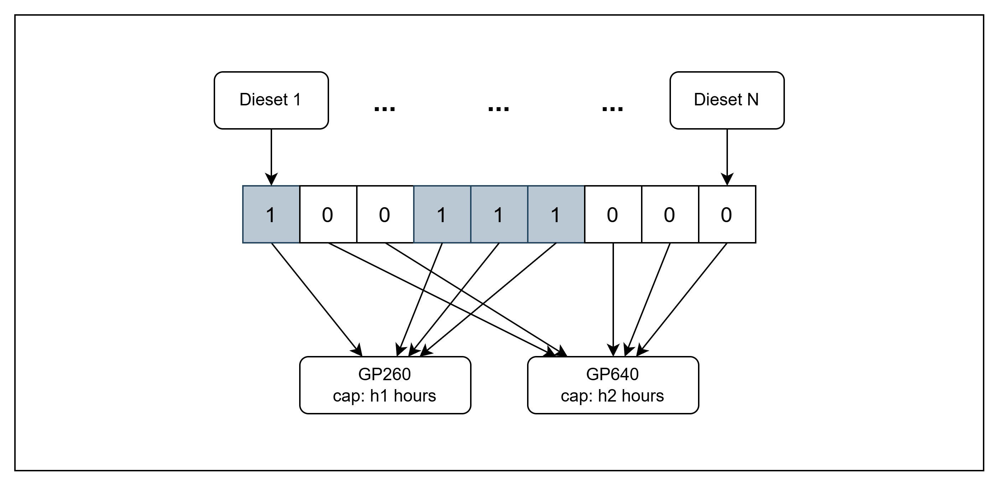

# Tugas Besar AI5103-28426004-13523144
> **Penerapan Genetic Algorithm dan Swarm Intelligence pada Dataset Path Matters**

Repositori ini merupakan tugas fundamentai AI dan datascience untuk dataset **Path Matters: Industrial Data Meet Quantum Optimization**, yaitu dataset optimasi industri nyata dari **press shop BMW** yang sebelumnya diselesaikan dengan **Quantum Annealing (D-Wave)**, **LR-QAOA (IBM)**, dan **Simulated Annealing**. Fokus tugas ini adalah menerapkan **Genetic Algorithm (GA)** dan **Swarm Intelligence (SI)** pada dataset tersebut.

---

## 1. Latar Belakang Masalah Industri

### 1.1 Konteks Press Shop BMW

Dalam produksi massal kendaraan, komponen body mobil seperti pintu, side-frame, dan panel dibentuk dari lembaran logam di sebuah **press shop**. Press shop berisi sejumlah **mesin press**. Setiap mesin membentuk logam menggunakan **dieset**/**toolkit**, yaitu alat cetak yang bentuknya spesifik untuk satu jenis komponen bodi.


Setiap dieset harus dipasang pada tepat satu mesin press. Total beban kerja sebuah mesin merupakan jumlah jam kerja dari semua dieset yang dialokasikan ke mesin tersebut, dengan ketentuan tidak boleh melebihi kapasitasnya pada periode produksi. Memasang dieset yang sama pada mesin berbeda menghasilkan total biaya yang berbeda, yang berasal dari efisiensi mesin (**production cost**) dan jarak antara press shop dengan assembly plant (**transport cost**).

Tugas perencanaan produksi ini adalah menentukan alokasi dieset ke mesin yang meminimalkan total biaya produksi dan transportasi, dengan tetap memenuhi batas kapasitas mesin dan memastikan setiap komponen yang dibutuhkan tetap diproduksi.

### 1.2 Formulasi Matematis

Mengikuti Schmidbauer et al. (2025), misalkan:

- $T$ = himpunan toolkit atau dieset
- $M$ = himpunan mesin press
- $c_{tm}$ = biaya alokasi toolkit $t$ ke mesin $m$
- $w_{tm}$ = beban kerja, dalam jam per periode, yang dibutuhkan toolkit $t$ pada mesin $m$
- $h_m$ = kapasitas maksimum, dalam jam per periode, dari mesin $m$

**Variabel keputusan**:

$$x_{tm} \in \{0,1\}, \quad x_{tm} = \begin{cases} 1 & \text{jika toolkit } t \text{ dialokasikan ke mesin } m \\ 0 & \text{lainnya} \end{cases}$$

| Aspek | Keterangan | Formulasi |
|-----------------------|----------------|----------------------|
| **Objective function** | meminimalkan total biaya produksi dan transportasi | $\min_{x} \sum_{t \in T} \sum_{m \in M} c_{tm} \, x_{tm}$ |
| **Capacity constraint** | beban kerja tiap mesin tidak boleh melebihi kapasitasnya | $\sum_{t \in T} w_{tm} \, x_{tm} \le h_m, \quad \forall m \in M$ |
| **Assignment constraint** | setiap toolkit harus dialokasikan tepat satu kali | $\sum_{m \in M} x_{tm} = 1, \quad \forall t \in T$ |

Pada dataset ini, beberapa toolkit hanya memiliki satu mesin yang feasible. Toolkit seperti ini bersifat **fixed**. Toolkit tersebut memberi konstribusi pada objective dan beban kapasitas, tetapi tidak memberikan kebebasan keputusan. Hanya toolkit dengan dua mesin feasible yang merupakan variabel keputusan. Toolkit yang **flezible** ini ditunjukkan dalam label `n_diesets` pada tiap instance.

---

## 2. Dataset Path Matters

### 2.1 Gambaran Umum Dataset

Dataset asli tersedia di Zenodo:

> **DOI:** [10.5281/zenodo.16269046](https://zenodo.org/records/16269046)
> **Paper:** Schmidbauer et al., *Path Matters: Industrial Data Meet Quantum Optimization*, IEEE QCE 2025. [arXiv:2504.16607](https://arxiv.org/abs/2504.16607)

Dataset ini berisi enam instance masalah yang diturunkan dari data produksi BMW, dengan ukuran **3, 9, 13, 16, 18, dan 19** dieset flexible. Semua instance menggunakan tepat dua mesin press, yaitu `GP260` dan `GP640`, serta disediakan dalam tiga varian QUBO, yaitu `raw`, `rounded`, dan `scaled`. Perbedaan varian ini hanya terdapat pada cara pemilihan bobot penalty dan penskalaan biaya saja. Field `model`, yang berisi data level bisnis seperti biaya, beban kerja, kapasitas, dan pilihan mesin, bernilai sama pada ketiga varian tersebut.

| Instance | Flexible diesets | Machines | Reference optimal cost |
|---------:|:----------------:|:--------:|----------------------:|
| 3-diesets  | 3  | 2 | 443483.2120455985 |
| 9-diesets  | 9  | 2 | 2249378.782446411 |
| 13-diesets | 13 | 2 | 5223596.118974955 |
| 16-diesets | 16 | 2 | 5803504.81935973 |
| 18-diesets | 18 | 2 | 5963876.622039333 |
| 19-diesets | 19 | 2 | 6115761.140002047 |

Solusi optimal ground truth, yaitu `optimal_bitstring` dan `optimal_cost`, dihitung oleh penulis asli menggunakan solver SCIP melalui Google OR-Tools pada binary linear program dasarnya, bukan pada QUBO.

### 2.2 Representasi QUBO Asli

Dataset asli mendistribusikan masalah dalam bentuk **Quadratic Unconstrained Binary Optimization (QUBO)** untuk quantum annealer dan sirkuit QAOA. Tiga varian QUBO berbeda pada cara pemilihan $\lambda_t$ dan $\lambda_m$ untuk penalty:

| Varian   | Pemilihan penalty |
|----------|-------------------|
| `raw`    | Grid search manual: $\lambda_m \in \{10^3, 10^4, 10^5\}$, $\lambda_t \in \{10^7, 10^8, 10^9\}$ |
| `scaled` | Constraint di-rescale ke rentang nilai objective, lalu $\lambda = 1$ |
| `rounded`| Biaya dibulatkan melalui integer division untuk menyeimbangkan matriks QUBO, lalu diperlakukan sama seperti `scaled` |

QUBO dengan 3 dieset flexible menjadi masalah 22 qubit setelah ekspansi slack, sedangkan instance 19 dieset menjadi masalah 60 qubit. Overhead ini, yang muncul karena kebutuhan mengodekan kedua constraint sebagai penalty pada perangkat yang hanya menerima variabel biner, sehingga masalah ini merupakan salah satu motivasi utama penggunaan formulasi metaheuristik pada percobaan ini.

### 2.3 Representasi Hasil Preprocessing

Direktori `data/processed/instances/` berisi enam instance yang diekstraksi ulang dari field `model.dieset_choices` pada file JSON asli. Seluruh artefak spesifik QUBO, seperti slack variable, penalty term, dan koefisien matriks, tidak disertakan. Setiap instance disimpan sebagai dokumen JSON terpisah dengan format:

```jsonc
{
  "n_diesets": 3,              // jumlah dieset yang perlu dialokasikan (gen kromosom)
  "n_machines": 2,
  "machines": [                 // kapasitas tiap mesin (jam per periode)
    {"machine_id": 24, "machine_name": "GP260", "capacity_hours": 953.03},
    {"machine_id": 27, "machine_name": "GP640", "capacity_hours": 146.65}
  ],
  "diesets": [                  // satu entri = satu gen kromosom
    {
      "dieset_id": 3,
      "choices": [               // pilihan mesin untuk dieset ini (index 0/1 = gen)
        {"machine_id": 24, "work_hours": 153.6, "total_cost": 301191.8, ...},
        {"machine_id": 27, "work_hours": 153.6, "total_cost": 237407.2, ...}
      ]
    },
    ...
  ],
  "ground_truth": {              // untuk hitung optimality gap / % near-optimal
    "optimal_cost": 443483.21,
    "optimal_assignment_dieset_to_machine": {"3": 24, "2": 27, "0": 27}
  }
}

```

Setiap entri `diesets[i].choices` bersesuaian dengan satu alokasi mesin yang feasible. Nilai `total_cost` dihitung dari jumlah biaya produksi dan transportasi, dan nilai `work_hours` merupakan kontribusi beban kerja ke mesin tersebut.

---

## 3. Representasi Masalah

### 3.1 Chromosome dan Particle Representation



Karena hanya dieset flexible yang menjadi variabel keputusan, representasi yang digunakan berupa **vektor kategorikal** sepanjang `n_diesets`:

$$\text{gene}[i] \in \{0, 1\}, \quad \text{gene}[i] = j \iff \text{dieset } i \text{ dialokasikan ke } \texttt{choices}[j]$$

Untuk keenam instance pada dataset ini, setiap dieset flexible memiliki tepat dua mesin feasible, sehingga ruang pencarian berupa hypercube biner berdimensi $n_\text{diesets}$, dengan paling banyak $2^{19} \approx 5.2 \times 10^5$ konfigurasi untuk instance terbesar. Assignment constraint sudah dapat dipastikan secara otomatis dengan representasi ini, karena setiap gene sudah pasti memilih tepat satu mesin. 

### 3.2 Fitness Function

Assignment constraint sudah terpenuhi oleh representasi, sehingga hanya capacity constraint yang ditangani melalui fungsi penalti. Fungsi fitness yang digunakan (semakin kecil semakin baik) adalah sebagai sebagai berikut:

$$f(\text{gene}) = \underbrace{\sum_i c_{i,\text{gene}[i]}}_{\text{objective}} \; + \; \lambda \underbrace{\sum_{m \in M} \max(0, \text{load}_m - h_m)^2}_{\text{penalti berjenjang}} \; + \; \lambda \underbrace{\mathbb{1}[\exists m: \text{load}_m > h_m]}_{\text{penalti feasibility}}$$

dengan $c_{i,j}$ = `choices[j].total_cost` dari dieset $i$ dan $\text{load}_m = \sum_{i \,:\, \text{gene}[i] \to m} \texttt{choices}[\text{gene}[i]].\texttt{work\_hours}$.

---

## 4. Rancangan Algoritma

lorem ipsum dolor sit amet

---

## 5. Rancangan Percobaan

lorem ipsum dolor sit amet

---

## 6. Hasil dan Observasi

lorem ipsum dolor sit amet

---

## Referensi

1. L. Schmidbauer, C. A. Riofrio, F. Heinrich, V. Junk, U. Schwenk, T. Husslein, and W. Mauerer. *Path Matters: Industrial Data Meet Quantum Optimization.* Proceedings of the IEEE International Conference on Quantum Computing and Engineering (QCE), 2025. arXiv:2504.16607.
2. Safi et al. *Reality Check on Quantum Optimization for Job-Shop Scheduling.* arXiv:2607.13325, 2026.
3. Thelen and Mauerer. *DQI-Kit: A Software Framework for Digital Quantum Integration.* arXiv:2605.16955, 2026.
4. Dataset: Zenodo, DOI [10.5281/zenodo.16269046](https://zenodo.org/records/16269046).

---

## Lisensi

Dataset asli dipublikasi dengan ketentuan lisensi yang tersedia pada `data/original/LICENSE`.