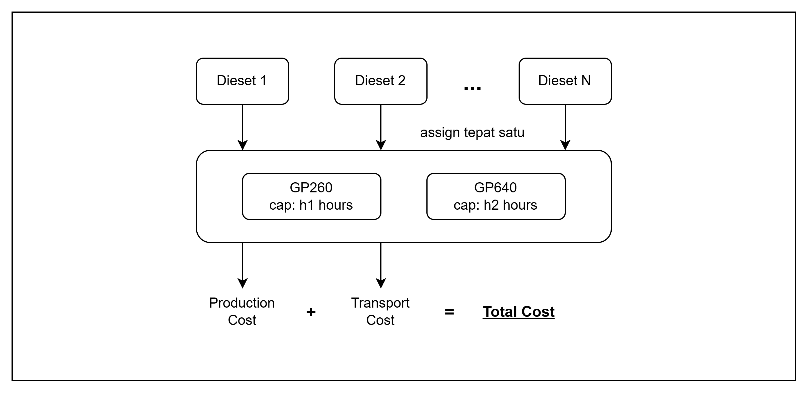

# Tugas Besar AI5103-28426004-13523144
> **Penerapan Genetic Algorithm dan Swarm Intelligence pada Dataset Path Matters**

Repositori ini merupakan tugas fundamentai AI dan datascience untuk dataset **Path Matters: Industrial Data Meet Quantum Optimization**, yaitu dataset optimasi industri nyata dari **press shop BMW** yang sebelumnya diselesaikan dengan **Quantum Annealing (D-Wave)**, **LR-QAOA (IBM)**, dan **Simulated Annealing**. Fokus tugas ini adalah menerapkan **Genetic Algorithm (GA)** dan **Swarm Intelligence (SI)** pada dataset tersebut.

---

## 1. Latar Belakang Masalah Industri

### 1.1 Konteks Press Shop BMW

Dalam produksi massal kendaraan, komponen body mobil seperti pintu, side-frame, dan panel dibentuk dari lembaran logam di sebuah **press shop**. Press shop berisi sejumlah **mesin press**. Setiap mesin membentuk logam menggunakan **dieset**/**toolkit**, yaitu alat cetak yang bentuknya spesifik untuk satu jenis komponen bodi.



Setiap dieset harus dipasang pada tepat satu mesin press. Total beban kerja sebuah mesin merupakan jumlah jam kerja dari semua dieset yang dialokasikan ke mesin tersebut, dengan ketentuan tidak boleh melebihi kapasitasnya pada periode produksi. Memasang dieset yang sama pada mesin berbeda menghasilkan total biaya yang berbeda, yang berasal dari efisiensi mesin (**production cost**) dan jarak antara press shop dengan assembly plant (**transport cost**).

Tugas perencanaan produksi ini adalah menentukan alokasi dieset ke mesin yang meminimalkan total biaya produksi dan transportasi, dengan tetap memenuhi batas kapasitas mesin dan memastikan setiap komponen yang dibutuhkan tetap diproduksi.

### 1.2 Formulasi Matematis

Mengikuti Schmidbauer et al. (2025), misalkan:

- $T$ = himpunan toolkit atau dieset
- $M$ = himpunan mesin press
- $c_{tm}$ = biaya alokasi toolkit $t$ ke mesin $m$
- $w_{tm}$ = beban kerja, dalam jam per periode, yang dibutuhkan toolkit $t$ pada mesin $m$
- $h_m$ = kapasitas maksimum, dalam jam per periode, dari mesin $m$

**Variabel keputusan**:

$$x_{tm} \in \{0,1\}, \quad x_{tm} = \begin{cases} 1 & \text{jika toolkit } t \text{ dialokasikan ke mesin } m \\ 0 & \text{lainnya} \end{cases}$$

| Aspek | Keterangan | Formulasi |
|-----------------------|----------------|----------------------|
| **Objective function** | meminimalkan total biaya produksi dan transportasi | $\min_{x} \sum_{t \in T} \sum_{m \in M} c_{tm} \, x_{tm}$ |
| **Capacity constraint** | beban kerja tiap mesin tidak boleh melebihi kapasitasnya | $\sum_{t \in T} w_{tm} \, x_{tm} \le h_m, \quad \forall m \in M$ |
| **Assignment constraint** | setiap toolkit harus dialokasikan tepat satu kali | $\sum_{m \in M} x_{tm} = 1, \quad \forall t \in T$ |

Pada dataset ini, beberapa toolkit hanya memiliki satu mesin yang feasible. Toolkit seperti ini bersifat **fixed**. Toolkit tersebut memberi konstribusi pada objective dan beban kapasitas, tetapi tidak memberikan kebebasan keputusan. Hanya toolkit dengan dua mesin feasible yang merupakan variabel keputusan. Toolkit yang **flezible** ini ditunjukkan dalam label `n_diesets` pada tiap instance.

---

## 2. Dataset Path Matters

### 2.1 Gambaran Umum Dataset

Dataset asli tersedia di Zenodo:

> **DOI:** [10.5281/zenodo.16269046](https://zenodo.org/records/16269046)
> **Paper:** Schmidbauer et al., *Path Matters: Industrial Data Meet Quantum Optimization*, IEEE QCE 2025. [arXiv:2504.16607](https://arxiv.org/abs/2504.16607)

Dataset ini berisi enam instance masalah yang diturunkan dari data produksi BMW, dengan ukuran **3, 9, 13, 16, 18, dan 19** dieset flexible. Semua instance menggunakan tepat dua mesin press, yaitu `GP260` dan `GP640`, serta disediakan dalam tiga varian QUBO, yaitu `raw`, `rounded`, dan `scaled`. Perbedaan varian ini hanya terdapat pada cara pemilihan bobot penalty dan penskalaan biaya saja. Field `model`, yang berisi data level bisnis seperti biaya, beban kerja, kapasitas, dan pilihan mesin, bernilai sama pada ketiga varian tersebut.

| Instance | Flexible diesets | Machines | Reference optimal cost (SCIP) | Brute-force optimal cost |
|---------:|:----------------:|:--------:|----------------------:|----------------------:|
| 3-diesets  | 3  | 2 | 443483.2120455985 | 443483.2120455985 |
| 9-diesets  | 9  | 2 | 2249378.782446411 | 2249378.782446411 |
| 13-diesets | 13 | 2 | 5223596.118974955 | 5223596.118974955 |
| 16-diesets | 16 | 2 | 5803504.81935973 | 5801121.210268822 |
| 18-diesets | 18 | 2 | 5963876.622039333 | 5962911.992764378 |
| 19-diesets | 19 | 2 | 6115761.140002047 | 6112960.592173959 |

Solusi optimal ground truth, yaitu `optimal_bitstring` dan `optimal_cost`, dihitung oleh penulis asli menggunakan solver SCIP melalui Google OR-Tools pada binary linear program dasarnya, bukan pada QUBO. Pada model tersebut, kapasitas mesin dibulatkan ke bawah dan beban kerja dibulatkan ke atas. Optimum brute-force adalah solusi feasible termurah dari enumerasi seluruh $2^{n}$ kombinasi pada model tanpa pembulatan.

### 2.2 Representasi QUBO Asli

Dataset asli mendistribusikan masalah dalam bentuk **Quadratic Unconstrained Binary Optimization (QUBO)** untuk quantum annealer dan sirkuit QAOA. Tiga varian QUBO berbeda pada cara pemilihan $\lambda_t$ dan $\lambda_m$ untuk penalty:

| Varian   | Pemilihan penalty |
|----------|-------------------|
| `raw`    | Grid search manual: $\lambda_m \in \{10^3, 10^4, 10^5\}$, $\lambda_t \in \{10^7, 10^8, 10^9\}$ |
| `scaled` | Constraint di-rescale ke rentang nilai objective, lalu $\lambda = 1$ |
| `rounded`| Biaya dibulatkan melalui integer division untuk menyeimbangkan matriks QUBO, lalu diperlakukan sama seperti `scaled` |

QUBO dengan 3 dieset flexible menjadi masalah 22 qubit setelah ekspansi slack, sedangkan instance 19 dieset menjadi masalah 60 qubit. Overhead ini, yang muncul karena kebutuhan mengodekan kedua constraint sebagai penalty pada perangkat yang hanya menerima variabel biner, sehingga masalah ini merupakan salah satu motivasi utama penggunaan formulasi metaheuristik pada percobaan ini.

### 2.3 Representasi Hasil Preprocessing

Direktori `data/processed/instances/` berisi enam instance yang diekstraksi ulang dari field `model.dieset_choices` pada file JSON asli oleh `data/processed/preprocess.py`. Seluruh artefak spesifik QUBO, seperti slack variable, penalty term, dan koefisien matriks, tidak disertakan. Dieset fixed tidak menjadi gen, tetapi beban kerjanya mengurangi kapasitas mesin. Setiap instance disimpan sebagai dokumen JSON terpisah dengan format:

```jsonc
{
  "n_diesets": 3,              // jumlah dieset yang perlu dialokasikan (gen kromosom)
  "n_machines": 2,
  "machines": [                 // kapasitas tiap mesin (jam per periode)
    {
      "machine_id": 24, "machine_name": "GP260",
      "capacity_hours": 155.87,         // kapasitas maksimum - beban dieset fixed
      "capacity_hours_rounded": 155,    // dibulatkan ke bawah, model SCIP
      "max_capacity_hours": 953.03,
      "fixed_load_hours": 797.16
    },
    ...
  ],
  "diesets": [                  // satu entri = satu gen kromosom
    {
      "dieset_id": 3,
      "choices": [               // pilihan mesin untuk dieset ini (index 0/1 = gen)
        {"machine_id": 24, "work_hours": 153.57, "work_hours_rounded": 154, "total_cost": 301191.82, ...},
        {"machine_id": 27, "work_hours": 153.57, "work_hours_rounded": 154, "total_cost": 237407.23, ...}
      ]
    },
    ...
  ],
  "ground_truth": {              // untuk hitung optimality gap / % near-optimal
    "optimal_cost": 443483.21,                // optimum SCIP dari paper
    "optimal_assignment_dieset_to_machine": {"3": 24, "2": 27, "0": 27},
    "brute_force_optimal_cost": 443483.21,    // optimum enumerasi, model tanpa pembulatan
    "brute_force_assignment_dieset_to_machine": {"3": 24, "2": 27, "0": 27},
    "n_feasible": 1,                          // jumlah kombinasi feasible
    "n_total": 8
  }
}

```

Setiap entri `diesets[i].choices` bersesuaian dengan satu alokasi mesin yang feasible. Nilai `total_cost` dihitung dari jumlah biaya produksi dan transportasi, dan nilai `work_hours` merupakan kontribusi beban kerja ke mesin tersebut.

---

## 3. Representasi Masalah

### 3.1 Chromosome dan Particle Representation


Karena hanya dieset flexible yang menjadi variabel keputusan, representasi yang digunakan berupa **vektor kategorikal** sepanjang `n_diesets`:

$$\text{gene}[i] \in \{0, 1\}, \quad \text{gene}[i] = j \iff \text{dieset } i \text{ dialokasikan ke } \texttt{choices}[j]$$

Untuk keenam instance pada dataset ini, setiap dieset flexible memiliki tepat dua mesin feasible, sehingga ruang pencarian berupa hypercube biner berdimensi $n_\text{diesets}$, dengan paling banyak $2^{19} \approx 5.2 \times 10^5$ konfigurasi untuk instance terbesar. Assignment constraint sudah dapat dipastikan secara otomatis dengan representasi ini, karena setiap gene sudah pasti memilih tepat satu mesin. 

### 3.2 Fitness Function

Assignment constraint sudah terpenuhi oleh representasi, sehingga hanya capacity constraint yang ditangani melalui fungsi penalti. Fungsi fitness yang digunakan (semakin kecil semakin baik) adalah sebagai sebagai berikut:

$$f(\text{gene}) = \underbrace{\sum_i c_{i,\text{gene}[i]}}_{\text{objective}} \; + \; \lambda \underbrace{\sum_{m \in M} \max(0, \text{load}_m - h_m)^2}_{\text{penalti berjenjang}} \; + \; \lambda \underbrace{\mathbb{1}[\exists m: \text{load}_m > h_m]}_{\text{penalti feasibility}}$$

dengan $c_{i,j}$ = `choices[j].total_cost` dari dieset $i$ dan $\text{load}_m = \sum_{i \,:\, \text{gene}[i] \to m} \texttt{choices}[\text{gene}[i]].\texttt{work\_hours}$. Nilai $\lambda$ sama dengan total biaya terbesar yang mungkin, $\sum_i \max_j c_{i,j}$, sehingga solusi infeasible selalu lebih buruk daripada solusi feasible.

---

## 4. Rancangan Algoritma

Ketiga algoritma diturunkan dari kelas `Algorithm` pada `src/algorithm/base.py` dan hanya memodifikasi dua langkah utama, yaitu `initialize()` untuk membangun populasi awal dan `iterate()` untuk satu generasi atau satu pembaruan swarm. Evaluasi fitness, pencatatan solusi terbaik, dan kriteria berhenti dijalankan oleh kelas dasar diluar algoritma. Kriteria berhenti yang tersedia adalah: jumlah evaluasi, jumlah iterasi, dan patience dalam satuan evaluasi.

### 4.1 Genetic Algorithm

Setiap generasi memilih pasangan parent, membentuk satu anak per pasangan melalui crossover dengan peluang $p_c$, memutasi anak, lalu menggabungkan anak dengan individu elit.

| Proses | Pilihan | Default |
|---|---|---|
| Seleksi | tournament, roulette wheel, rank | tournament ukuran 3 |
| Crossover | one-point, two-point, uniform | uniform, $p_c = 0{,}9$ |
| Mutasi | bit-flip (gen pindah ke mesin lain), swap (tukar nilai dua gen) | bit-flip, $p_m = 1/n$ |
| Populasi | | 40 individu, elitisme 2 |

- Roulette wheel menggunakan bobot $f_{max} - f$ untuk meminimalkan fitness. 
- Rank selection memberikan bobot dari $P$ untuk individu terbaik sampai 1 untuk individu terburuk secara linear, dengan $P$ merupakan ukuran populasi.

### 4.2 Binary Particle Swarm Optimization

Kecepatan partikel $i$ pada dimensi $d$ diperbarui dengan

$$v_{id} \leftarrow w\,v_{id} + c_1 r_1 (p_{id} - x_{id}) + c_2 r_2 (g_d - x_{id}), \qquad r_1, r_2 \sim U(0,1)$$

lalu dibatasi pada $[-v_{max}, v_{max}]$, dengan $p_i$ posisi terbaik partikel $i$ dan $g$ posisi terbaik swarm. Posisi biner baru ditentukan oleh fungsi transfer sebagai berikut.

| Transfer | Rumus | Aturan posisi |
|---|---|---|
| Sigmoid (S-shaped) | $S(v) = 1 / (1 + e^{-v})$ | $x_{id} = 1$ jika $r < S(v_{id})$ |
| V-shaped | $T(v) = \lvert \tanh(v) \rvert$ | $x_{id}$ dibalik jika $r < T(v_{id})$ |

- Inertia $w$ dapat bernilai konstan ataupun turun secara linear dari $w_0$ ke $w_{end}$ sepanjang budget evaluasi.
- Konfigurasi default menggunakan transfer sigmoid, $w = 0{,}7$, $c_1 = c_2 = 1{,}5$, $v_{max} = 4$, dan swarm 40 partikel.

### 4.3 Random Search

Random search membangkitkan sejumlah genome acak di setiap iterasi tanpa menggunakan informasi dari solusi sebelumnya. Algoritma ini menjadi baseline, sama seperti random reference pada paper.

---

## 5. Rancangan Percobaan

### 5.1 Optimum Pembanding

Optimum pembanding dipilih melalui konstanta `OPTIMUM` di setiap notebook.

| `OPTIMUM` | Model data | Pembanding gap |
|---|---|---|
| `scip` | kapasitas dan beban dibulatkan seperti paper | optimum SCIP |
| `brute-force` | nilai asli | optimum brute-force |
| `both` | nilai asli | optimum brute-force, dengan solusi SCIP sebagai garis pembanding pada plot |

Hasil pada repositori ini menggunakan `both`.

### 5.2 Konfigurasi Percobaan

Setiap konfigurasi dijalankan pada keenam instance sebanyak 30 run per instance. Seed setiap run diacak dari master seed 2026, dan daftar seed yang sama dipakai untuk semua konfigurasi. Setiap run berhenti setelah 5.000 evaluasi fitness, tanpa patience. Optimum pembanding, jumlah run, master seed, budget, dan hyperparameter setiap konfigurasi disimpan di `configs/experiment.json` dan dibaca oleh semua notebook.

| Algoritma | Konfigurasi |
|---|---|
| Random search | genome per iterasi 20, 40, dan 80 |
| BPSO | default, inertia linear, V-shaped, V-shaped dengan inertia linear, swarm 20, swarm 80, $v_{max} = 6$ |
| GA | default, roulette wheel, rank, one-point, two-point, swap, populasi 20, populasi 80 |

- Konfigurasi selain default hanya mengubah satu proses atau parameter. 
- Konfigurasi terbaik tiap algoritma ditentukan dari rata-rata lintas instance, dengan urutan prioritas % feasible tertinggi, % near-optimal tertinggi, lalu gap rata-rata terkecil. Konfigurasi terbaik inilah yang dibandingkan antar algoritma pada `comparison.ipynb`.

### 5.3 Metrik Evaluasi

| Metrik | Definisi |
|---|---|
| % feasible | persentase run yang solusi akhirnya memenuhi capacity constraint (Fig. 3 paper) |
| % near-optimal | persentase run feasible dengan gap paling besar 1% (Fig. 4 paper) |
| Rasio cost terbaik | cost feasible terendah dari seluruh run dibagi optimum (Fig. 5 paper) |
| Optimality gap | $(\text{cost} - \text{cost}^*) / \text{cost}^* \times 100\%$ |
| % optimum ditemukan | persentase run dengan gap 0 |
| Waktu eksekusi | detik per run |
| Iterasi dan evaluasi sampai solusi terbaik | iterasi dan jumlah evaluasi saat solusi terbaik run pertama kali ditemukan |
| Statistik gap | gap terbaik, rata-rata, simpangan baku, dan terburuk dari 30 run |
| Uji signifikansi | Wilcoxon rank-sum antar pasangan algoritma per instance, $\alpha = 0{,}05$. Dipilih karena distribusi gap tidak normal (banyak run bernilai tepat 0) |

Setiap metrik evaluasi diplot terhadap jumlah dieset untuk melihat scalability. Evaluasi dilakukan pada tiga tingkat: 
1. Sebaran 30 run per instance untuk setiap konfigurasi.
2. Perbandingan antar konfigurasi dalam satu algoritma. 
3. Perbandingan antar algoritma. 

### 5.4 Struktur Kode dan Cara Menjalankan

```text
data/processed/preprocess.py   preprocessing dataset asli
configs/experiment.json        optimum, seed, budget, dan konfigurasi tiap algoritma
src/problem.py                 instance, objective, dan constraint
src/algorithm/                 base, genetic, swarm, random_search
src/evaluation/                runner, metrik, uji statistik, plot, dan demo
experiments/                   notebook per algoritma, comparison.ipynb, demo.ipynb, run_all.py
exp_results/                   tabel (CSV) dan gambar; hasil run mentah (JSON) di exp_results/runs tidak di-commit
```

Instalasi, lalu reproduksi seluruh tabel dan gambar dengan satu perintah:

```bash
uv sync                                  # atau: pip install numpy pandas matplotlib ipykernel nbformat nbclient scipy
uv run python experiments/run_all.py     # sekitar 6 menit
```

`run_all.py` menjalankan `random_search.ipynb`, `swarm.ipynb`, dan `genetic.ipynb`, lalu `comparison.ipynb` yang membaca hasilnya dari `exp_results/runs/`. Tabel tersimpan di `exp_results/tables/` dan gambar di `exp_results/figures/`. Hasil yang dibuat ulang identik dengan yang di repositori, kecuali kolom waktu eksekusi yang bergantung pada mesin.

Perintah lain:

```bash
uv run python data/processed/preprocess.py        # membuat ulang data/processed/instances (sudah tersedia di repo)
uv run python experiments/run_all.py comparison   # hanya notebook tertentu
uv run python experiments/run_all.py --save       # sekaligus menyimpan output sel ke notebook
```

Demo langsung (GA, BPSO, dan random search pada satu instance, dengan kurva konvergensi yang bergerak) dijalankan dari `experiments/demo.ipynb`.

---

## 6. Hasil dan Observasi

- Seluruh run GA, BPSO, dan random search menghasilkan solusi feasible dengan gap di bawah 1%. 
- Instance 3 dan 9 selalu mencapai optimum. 

Tabel berikut merangkum gap rata-rata konfigurasi terbaik tiap algoritma terhadap optimum brute-force.

| n | GA `sel_rank` (%) | BPSO `sigmoid_s20` (%) | Random search (%) | Solusi SCIP (%) |
|---:|---:|---:|---:|---:|
| 13 | 0,0072 | 0,0024 | 0,0077 | 0 |
| 16 | 0,0220 | 0,0180 | 0,0697 | 0,0411 |
| 18 | 0,0084 | 0,0101 | 0,0412 | 0,0162 |
| 19 | 0,0338 | 0,0308 | 0,0948 | 0,0458 |


Key Insight:
- GA dan BPSO menghasilkan kualitas yang berdekatan dan jauh lebih baik daripada random search dimulai dari instance 16. 
- Uji Wilcoxon rank-sum: GA dan BPSO tidak berbeda signifikan di semua instance ($p > 0{,}3$), sedangkan keduanya signifikan lebih baik daripada random search mulai instance 16 ($p < 0{,}001$).
- Kedua Gap rata-rata lebih kecil daripada gap solusi SCIP pada instance 16, 18, dan 19. 
- Pada GA, operator seleksi memberikan pengaruh terbesar, sedangkan pada BPSO transfer sigmoid lebih baik daripada V-shaped saat inertia konstan. 
- Waktu eksekusi rata-rata BPSO 0,018 detik per run, lebih cepat dibanding GA dengan 0,081 detik per run.

Pembahasan lengkap tersedia pada dokumen berikut:
- [Hasil Genetic Algorithm](docs/results/genetic.md)
- [Hasil Binary PSO](docs/results/swarm.md)
- [Perbandingan antar algoritma](docs/results/comparison.md)

---

## Referensi

1. L. Schmidbauer, C. A. Riofrio, F. Heinrich, V. Junk, U. Schwenk, T. Husslein, and W. Mauerer. *Path Matters: Industrial Data Meet Quantum Optimization.* Proceedings of the IEEE International Conference on Quantum Computing and Engineering (QCE), 2025. arXiv:2504.16607.
2. Safi et al. *Reality Check on Quantum Optimization for Job-Shop Scheduling.* arXiv:2607.13325, 2026.
3. Thelen and Mauerer. *DQI-Kit: A Software Framework for Digital Quantum Integration.* arXiv:2605.16955, 2026.
4. Dataset: Zenodo, DOI [10.5281/zenodo.16269046](https://zenodo.org/records/16269046).
5. D. E. Goldberg. *Genetic Algorithms in Search, Optimization, and Machine Learning.* Addison-Wesley, 1989.
6. J. Kennedy and R. C. Eberhart. *A discrete binary version of the particle swarm algorithm.* IEEE International Conference on Systems, Man, and Cybernetics, 1997.
7. Y. Shi and R. Eberhart. *A modified particle swarm optimizer.* IEEE International Conference on Evolutionary Computation, 1998.
8. S. Mirjalili and A. Lewis. *S-shaped versus V-shaped transfer functions for binary Particle Swarm Optimization.* Swarm and Evolutionary Computation, 9:1-14, 2013.

---

## Lisensi

Dataset asli dipublikasi dengan ketentuan lisensi yang tersedia pada `data/original/LICENSE`.
