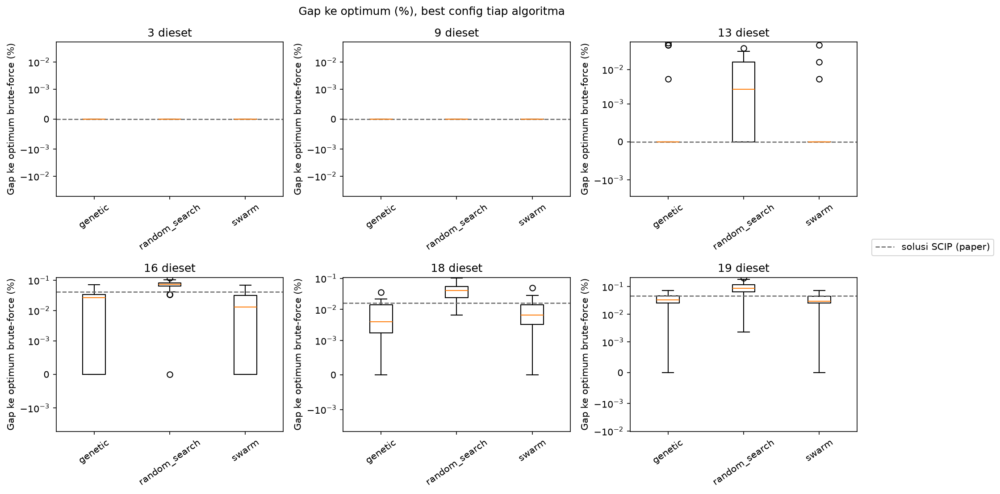
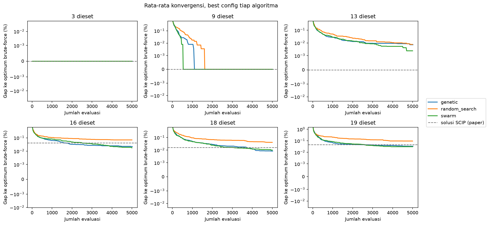
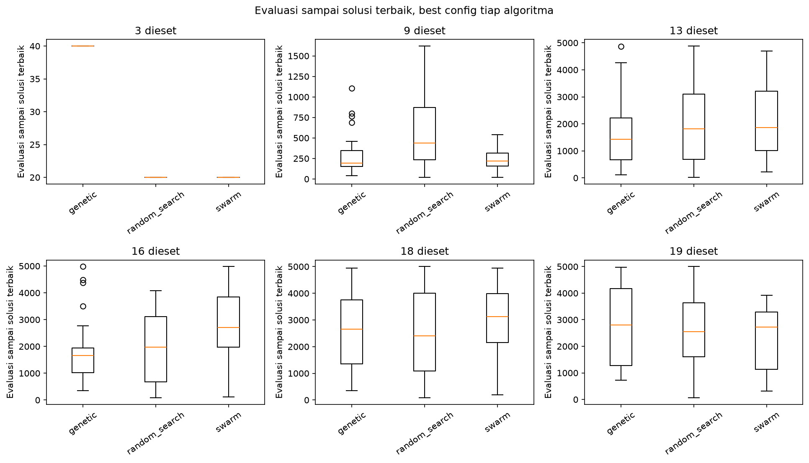
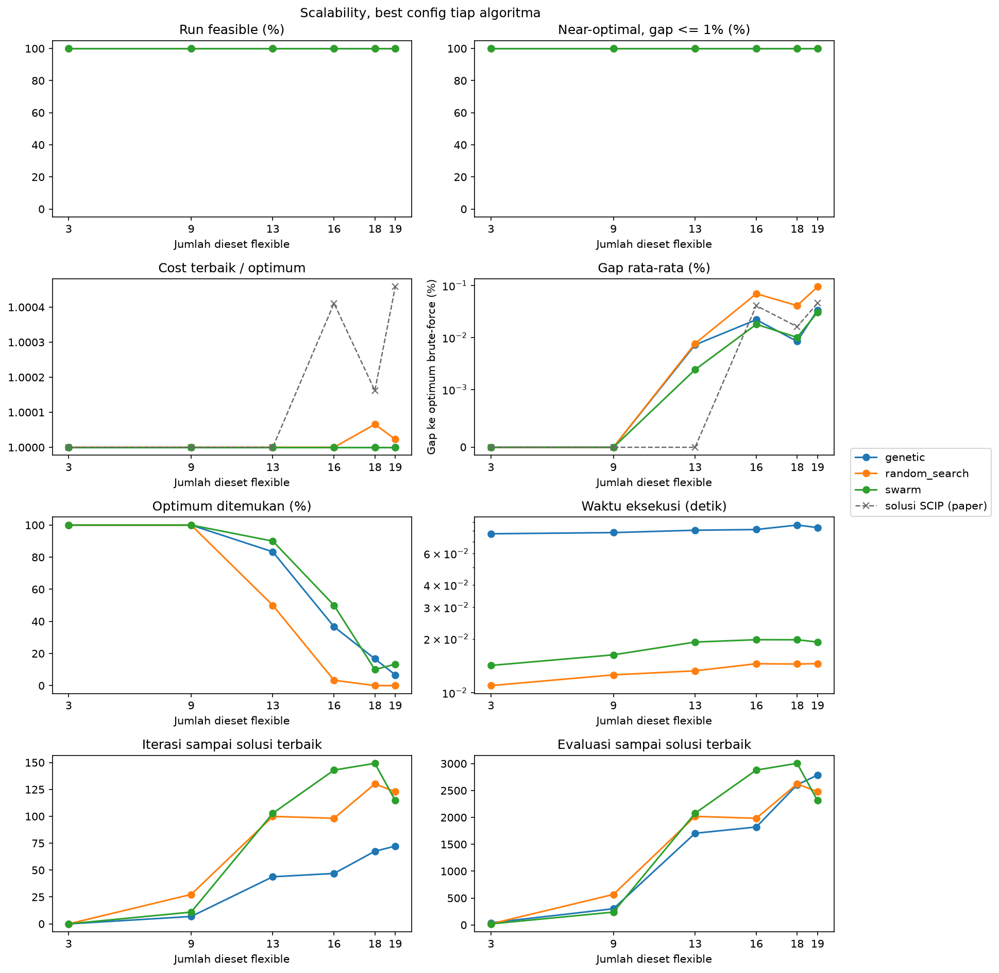

# Perbandingan Antar Algoritma

Setiap algoritma diwakili oleh konfigurasi terbaiknya, yaitu `sel_rank` untuk GA, `sigmoid_s20` untuk BPSO, dan `batch_20` untuk random search. Pada eksperimen ini, gap dihitung berdasarkan optimum brute-force.

## Kualitas Solusi

Hasil menunjukkan bahwa seluruh run ketiga algoritma feasible dan memiliki gap di bawah 1%. Dengan demikian, kriteria near-optimal 1% dari paper tidak membedakan ketiga algoritma pada dataset ini. Instance 3 dan 9 selalu mencapai optimum, sehingga tabel berikut hanya memuat instance 13 sampai 19.

| n | Gap GA (%) | Gap BPSO (%) | Gap random (%) | Gap solusi SCIP (%) | Optimum ditemukan GA / BPSO / random (%) |
|---:|---:|---:|---:|---:|---|
| 13 | 0,0072 | 0,0024 | 0,0077 | 0 | 83,3 / 90,0 / 50,0 |
| 16 | 0,0220 | 0,0180 | 0,0697 | 0,0411 | 36,7 / 50,0 / 3,3 |
| 18 | 0,0084 | 0,0101 | 0,0412 | 0,0162 | 16,7 / 10,0 / 0,0 |
| 19 | 0,0338 | 0,0308 | 0,0948 | 0,0458 | 6,7 / 13,3 / 0,0 |

1. GA dan BPSO menghasilkan kualitas yang berdekatan. BPSO unggul di instance 13, 16, dan 19, sedangkan GA unggul di instance 18. 
2. Mulai instance 16, gap rata-rata random search 3 sampai 5 kali lebih besar daripada GA dan BPSO.
3. GA dan BPSO mencapai optimum minimal sekali di setiap instance, sehingga rasio cost terbaik terhadap optimum bernilai 1 di semua instance. Random search tidak pernah mencapai optimum di instance 18 dan 19 (rasio 1,00007 dan 1,00002).
4. Solusi SCIP optimal untuk model dengan kapasitas dibulatkan, sedangkan percobaan ini memakai model tanpa pembulatan. Pada model ini, persentase run yang lebih murah daripada solusi SCIP adalah sebagai berikut.

| Algoritma | n=16 (%) | n=18 (%) | n=19 (%) |
|---|---:|---:|---:|
| GA | 93,3 | 83,3 | 70,0 |
| BPSO | 86,7 | 80,0 | 80,0 |
| Random search | 13,3 | 6,7 | 6,7 |

## Konvergensi dan Waktu

1. GA dan BPSO turun lebih cepat daripada random search sejak ratusan evaluasi pertama. Di instance 9, solusi terbaik ditemukan rata-rata setelah 239 evaluasi oleh BPSO, 301 oleh GA, dan 567 oleh random search.
2. Di instance 16, 18, dan 19, solusi terbaik ketiga algoritma rata-rata baru ditemukan setelah 1.800 sampai 3.000 evaluasi. Median BPSO di instance 16 dan median GA di instance 18 masih turun setelah evaluasi ke-4.000, sehingga budget 5.000 evaluasi belum cukup untuk konvergen penuh pada instance tersebut.
3. Waktu eksekusi rata-rata per run adalah 0,081 detik untuk GA, 0,018 detik untuk BPSO, dan 0,013 detik untuk random search. Biaya per evaluasi GA lebih tinggi karena operator crossover dan mutasi dijalankan per anak.

## Scalability

1. Persentase run yang mencapai optimum turun seiring bertambahnya jumlah dieset, dari 100% di instance 3 dan 9 menjadi paling tinggi 13,3% di instance 19.
2. Gap random search naik paling cepat, dari 0,0077% di instance 13 menjadi 0,0948% di instance 19. Gap GA dan BPSO tetap di bawah 0,035% di semua instance.
3. Kesulitan instance tidak hanya ditentukan oleh jumlah dieset. Instance 18 lebih mudah dibanding instance 16 dan 19 untuk ketiga algoritma.
