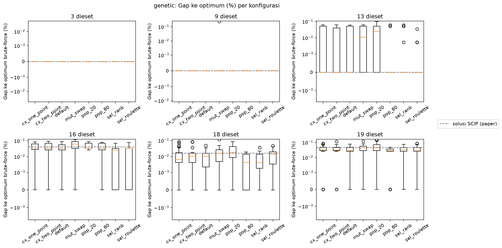
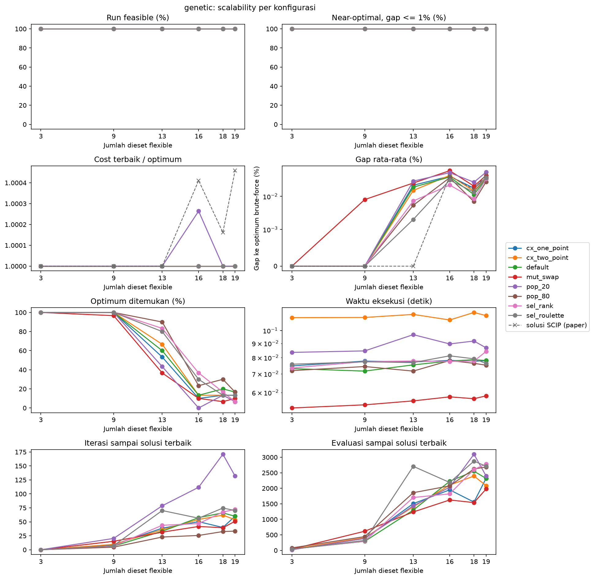

# Hasil Percobaan Genetic Algorithm

Delapan konfigurasi GA dijalankan pada enam instance dengan 30 seed per instance dan budget 5.000 evaluasi per run. Gap dihitung terhadap optimum brute-force.

| Konfigurasi | Perbedaan dari default |
|---|---|
| `default` | tournament selection (ukuran 3), uniform crossover (rate 0,9), bit-flip mutation (rate $1/n$), populasi 40, elitisme 2 |
| `sel_roulette` | roulette wheel selection |
| `sel_rank` | rank selection |
| `cx_one_point` | one-point crossover |
| `cx_two_point` | two-point crossover |
| `mut_swap` | swap mutation |
| `pop_20` | populasi 20 |
| `pop_80` | populasi 80 |

## Analisis Sensitivitas

Setiap konfigurasi mengubah satu proses atau parameter dari default, sehingga perbandingan antar konfigurasi menunjukkan sensitivitas GA terhadap seleksi, crossover, mutasi, dan ukuran populasi.

Seluruh 1.440 run menghasilkan solusi feasible dengan gap di bawah 1%. Di instance 3 dan 9 hanya ada satu run yang tidak mencapai optimum, yaitu satu run `mut_swap` di instance 9. Konfigurasi berikut ini diurutkan dari peringkat terbaik.

| Konfigurasi | Gap n=13 (%) | Gap n=16 (%) | Gap n=18 (%) | Gap n=19 (%) | Gap rata-rata 6 instance (%) | Optimum ditemukan (%) |
|---|---:|---:|---:|---:|---:|---:|
| `sel_rank` | 0,0072 | 0,0220 | 0,0084 | 0,0338 | 0,0119 | 57,2 |
| `pop_80` | 0,0054 | 0,0367 | 0,0069 | 0,0277 | 0,0128 | 60,0 |
| `sel_roulette` | 0,0020 | 0,0311 | 0,0135 | 0,0366 | 0,0139 | 56,1 |
| `default` | 0,0190 | 0,0387 | 0,0113 | 0,0343 | 0,0172 | 51,7 |
| `cx_two_point` | 0,0152 | 0,0431 | 0,0145 | 0,0381 | 0,0185 | 50,0 |
| `cx_one_point` | 0,0218 | 0,0408 | 0,0177 | 0,0375 | 0,0196 | 48,3 |
| `mut_swap` | 0,0254 | 0,0600 | 0,0204 | 0,0432 | 0,0262 | 43,3 |
| `pop_20` | 0,0289 | 0,0523 | 0,0268 | 0,0542 | 0,0270 | 43,9 |

Diatas merupakan Boxplot gap 30 seed per konfigurasi. Garis putus-putus merupakan gap solusi SCIP dari paper.

## Observasi

1. Ukuran populasi merupakan parameter yang paling berpengaruh. Gap rata-rata turun dalam rentang terbesar diantara semua variasi, dari 0,0270% (populasi 20) menjadi 0,0172% (populasi 40) dan 0,0128% (populasi 80). Berbeda dengan BPSO, populasi besar lebih baik pada GA.
2. Diantara operator, seleksi memberikan perbaikan yang terbesar. Rank dan roulette selection menurunkan gap rata-rata default dari 0,0172% menjadi 0,0119% dan 0,0139%, terutama di instance 13 (dari 0,0190% menjadi 0,0072% dan 0,0020%). Tournament berukuran 3 memberikan tekanan seleksi paling kuat di antara ketiganya, sehingga populasi default kemungkinan konvergen terlalu cepat.
3. Uniform crossover lebih baik daripada one-point (0,0196%) dan two-point (0,0185%).
4. Swap mutation merupakan variasi operator terburuk, dengan gap rata-rata 0,0262% dan gap maksimum 0,110%. Swap hanya menukar nilai dua gen, sehingga mutasi tidak mengubah jumlah dieset di tiap mesin.
5. Seperti pada BPSO, instance 16 dan 19 lebih sulit daripada instance 18 di semua konfigurasi.
