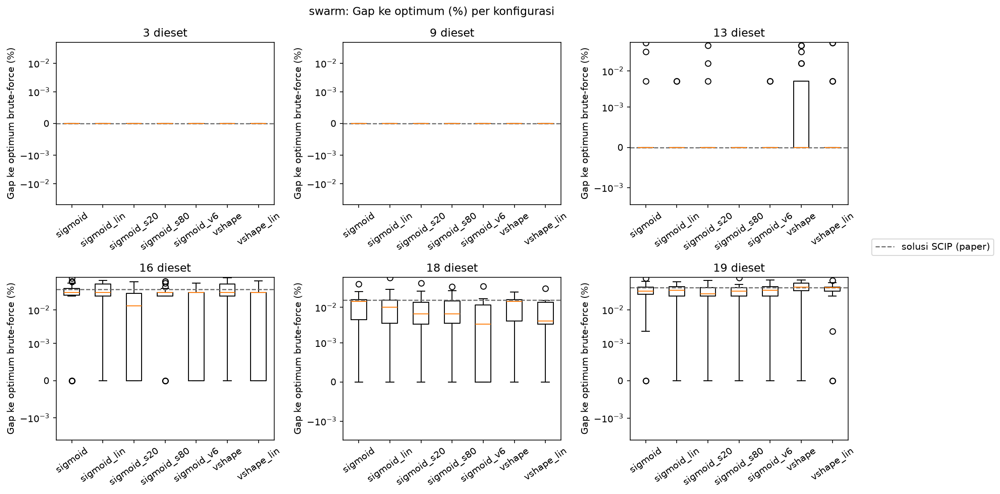
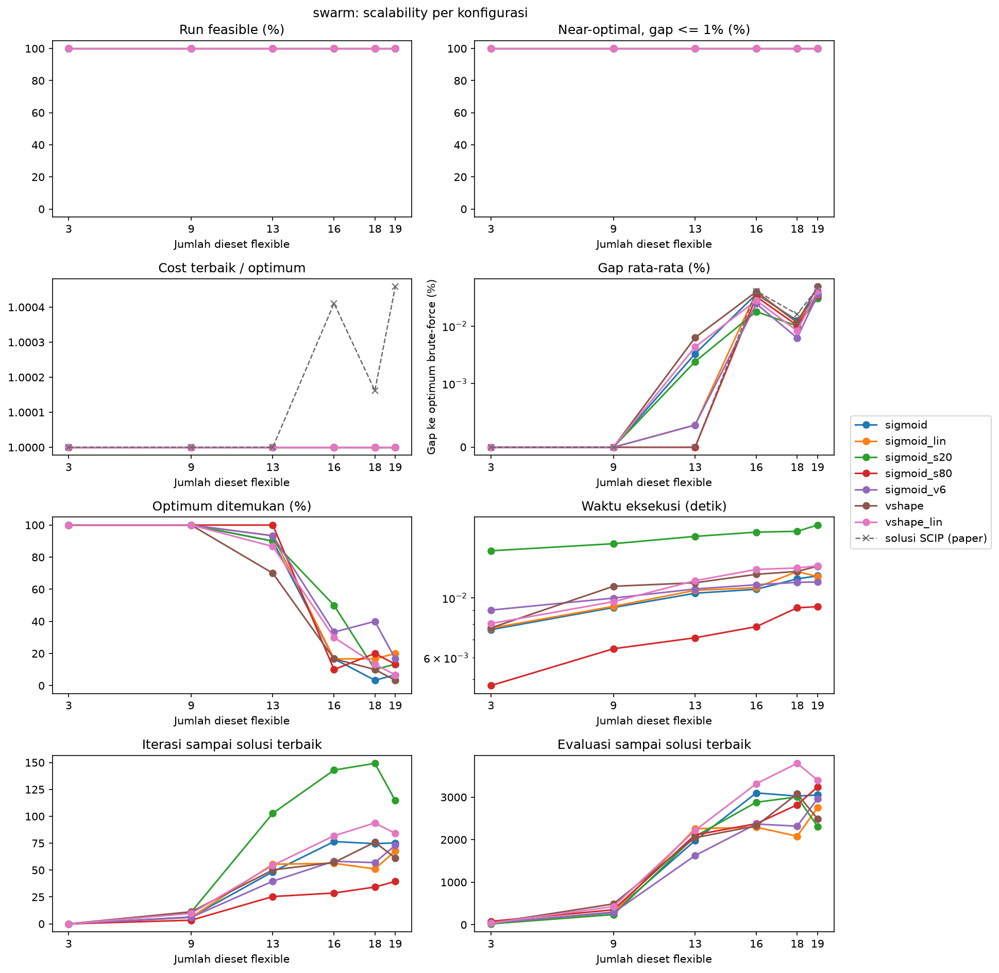

# Hasil Percobaan Binary PSO

Tujuh konfigurasi BPSO dijalankan pada enam instance dengan 30 seed per instance dan budget 5.000 evaluasi per run. Gap dihitung terhadap optimum brute-force.

| Konfigurasi | Perbedaan dari default |
|---|---|
| `sigmoid` | default: transfer sigmoid, inertia 0,7, $c_1 = c_2 = 1{,}5$, `v_max` 4, swarm 40 |
| `sigmoid_lin` | inertia turun linear dari 0,9 ke 0,4 |
| `vshape` | transfer V-shaped |
| `vshape_lin` | transfer V-shaped, inertia turun linear dari 0,9 ke 0,4 |
| `sigmoid_s20` | swarm 20 |
| `sigmoid_s80` | swarm 80 |
| `sigmoid_v6` | `v_max` 6 |

## Analisis Sensitivitas

Setiap konfigurasi mengubah satu proses atau parameter dari default, sehingga perbandingan antar konfigurasi menunjukkan sensitivitas BPSO terhadap fungsi transfer, jadwal inertia, ukuran swarm, dan `v_max`.

Seluruh 1.260 run menghasilkan solusi feasible dengan gap di bawah 1%. Instance 3 dan 9 selalu mencapai optimum di semua konfigurasi, sehingga tabel berikut hanya memuat instance 13 sampai 19. Konfigurasi diurutkan dari peringkat terbaik.

| Konfigurasi | Gap n=13 (%) | Gap n=16 (%) | Gap n=18 (%) | Gap n=19 (%) | Gap rata-rata 6 instance (%) | Optimum ditemukan (%) |
|---|---:|---:|---:|---:|---:|---:|
| `sigmoid_s20` | 0,0024 | 0,0180 | 0,0101 | 0,0308 | 0,0102 | 60,6 |
| `sigmoid_v6` | 0,0003 | 0,0246 | 0,0062 | 0,0352 | 0,0111 | 63,9 |
| `sigmoid_s80` | 0,0000 | 0,0327 | 0,0103 | 0,0336 | 0,0128 | 57,2 |
| `vshape_lin` | 0,0043 | 0,0281 | 0,0083 | 0,0415 | 0,0137 | 56,1 |
| `sigmoid_lin` | 0,0003 | 0,0389 | 0,0116 | 0,0328 | 0,0139 | 57,8 |
| `sigmoid` | 0,0033 | 0,0362 | 0,0125 | 0,0376 | 0,0149 | 52,8 |
| `vshape` | 0,0063 | 0,0399 | 0,0117 | 0,0486 | 0,0177 | 50,0 |

Diatas merupakan Boxplot gap 30 seed per konfigurasi. Garis putus-putus merupakan gap solusi SCIP dari paper.

## Observasi

1. Konfigurasi terbaik adalah `sigmoid_s20` dengan gap rata-rata 0,0102%, dan yang terburuk adalah `vshape` dengan 0,0177%. Selisih antar konfigurasi lebih kecil daripada sebaran antar seed di boxplot, sehingga urutan peringkat tengah dapat berubah jika seed diganti.
2. Dengan inertia konstan, transfer sigmoid lebih baik daripada V-shaped di instance 13, 16, dan 19. Inertia linear memperbaiki V-shaped lebih banyak (0,0177% menjadi 0,0137%) dibanding sigmoid (0,0149% menjadi 0,0139%), sehingga kedua fungsi transfer hampir setara dengan inertia linear.
3. Ukuran swarm merupakan parameter yang paling berpengaruh. Swarm 20 menurunkan gap rata-rata default terbesar di antara semua variasi, dari 0,0149% menjadi 0,0102%. Pengaruh ukuran swarm ini tidak bersifat monoton, karena swarm 80 (0,0128%) juga lebih baik daripada swarm 40. Dengan budget evaluasi yang sama, swarm 20 mendapat 249 iterasi, swarm 40 mendapat 124 iterasi, dan swarm 80 mendapat 62 iterasi.
4. `v_max` 6 memberi persentase optimum tertinggi (63,9%), terutama di instance 18 dengan 40% run mencapai optimum.
5. Gap tidak selalu naik terhadap jumlah dieset. Instance 16 dan 19 lebih sulit daripada instance 18 di semua konfigurasi.
