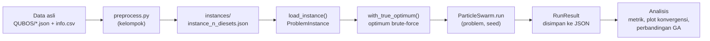
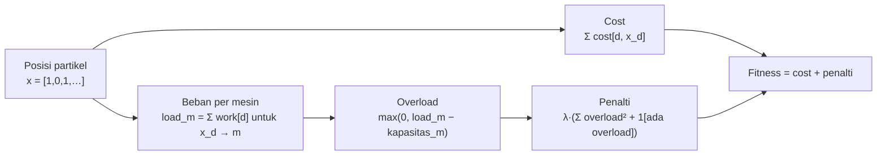
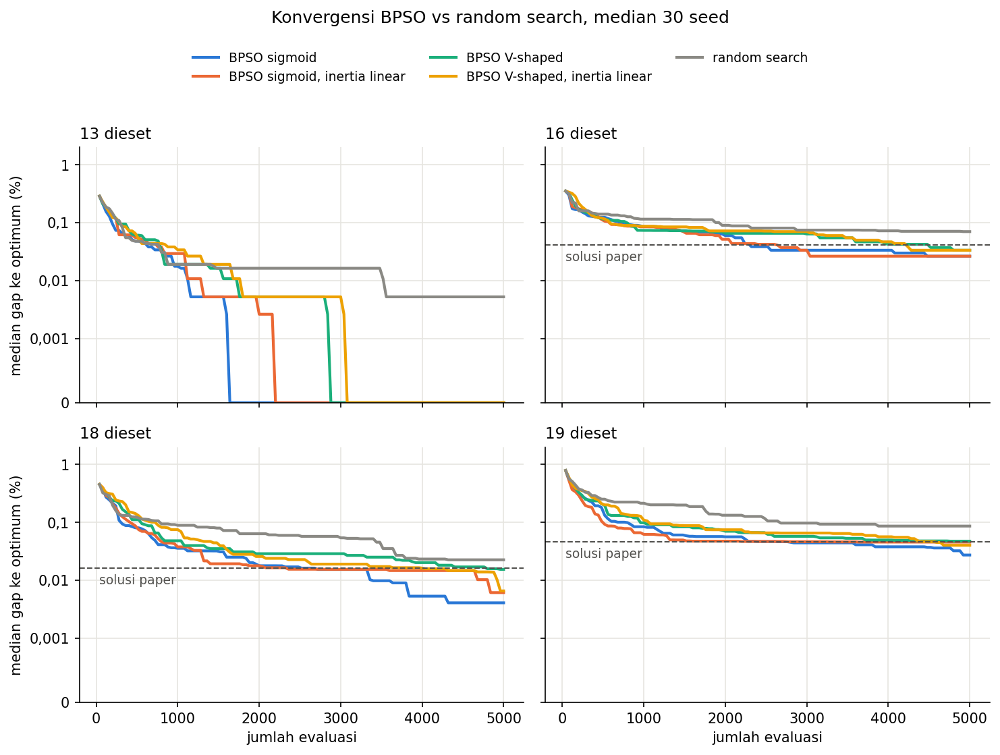

# Penerapan Swarm Intelligence: Binary PSO

> Bagian **Swarm Intelligence** dari tugas besar AI5103 pada dataset *Path Matters*.

Bagian ini memakai **Binary Particle Swarm Optimization (BPSO)** untuk mengalokasikan dieset flexible ke mesin `GP260` atau `GP640` dengan biaya minimum. Alasan pemilihannya dijelaskan di §2, dan alur prosesnya di §3.

Data yang dipakai adalah instance kelompok di `data/processed/instances/` (hasil `preprocess.py`), sama seperti GA. Satu-satunya tambahan: optimum untuk menghitung gap diambil dari brute-force (`src/optimum.py`), bukan dari nilai paper. Alasannya ada di §1.

---

## 1. Temuan Data yang Memengaruhi Desain

Brute-force atas semua $2^n$ kombinasi (paling banyak 524.288 untuk $n = 19$, kurang dari 1 detik) menghasilkan tiga temuan.

**a. Optimum paper bukan optimum terbaik untuk instance 16, 18, dan 19.**
Brute-force menemukan solusi feasible yang lebih murah 0,016–0,046%. Jika gap dihitung terhadap `optimal_cost` dari paper, sebuah algoritma bisa mendapat gap negatif, dan success rate menjadi tidak bermakna. Karena itu, semua metrik di bagian ini dihitung terhadap optimum brute-force (§4).

| n dieset | Optimum brute-force | Optimum paper | Selisih paper |
|---:|---:|---:|---:|
| 3  | 443.483,21   | 443.483,21   | 0       |
| 9  | 2.249.378,78 | 2.249.378,78 | 0       |
| 13 | 5.223.596,12 | 5.223.596,12 | 0       |
| 16 | 5.801.121,21 | 5.803.504,82 | +0,041% |
| 18 | 5.962.911,99 | 5.963.876,62 | +0,016% |
| 19 | 6.112.960,59 | 6.115.761,14 | +0,046% |

**b. Kapasitas mesin belum dikurangi beban dieset fixed.**
Semua dieset fixed dialokasikan ke `GP260`, tetapi `preprocess.py` memakai kapasitas penuh. Contohnya pada instance 3: dieset fixed sudah memakai 797,16 dari 953,03 jam. Hal ini **tidak mengubah optimum**, karena brute-force memberi solusi terbaik yang sama dengan kedua versi kapasitas. Yang berubah hanya luas ruang feasible:

| n dieset | Fraksi feasible (data kelompok) | Fraksi feasible (jika dikurangi beban fixed) |
|---:|---:|---:|
| 3  | 50,0% | 12,5% |
| 9  | 66,6% | 35,0% |
| 13 | 72,6% | 36,0% |
| 16 | 76,4% | 42,5% |
| 18 | 80,7% | 43,8% |
| 19 | 88,4% | 42,4% |

Kelompok memutuskan memakai data apa adanya, dan hal ini dicatat sebagai keterbatasan (§4.3).

**c. Masalahnya berstruktur 0/1 knapsack.**
- Untuk setiap dieset, gen 0 selalu `GP260` dan gen 1 selalu `GP640`.
- `work_hours` sebuah dieset sama di kedua mesin.
- `GP640` lebih murah untuk hampir semua dieset, kecuali satu dieset di instance 19.

Untuk $n \ge 9$, optimum menempel di batas kapasitas `GP640`, dengan utilisasi 99,4–99,9%. Solusi yang hampir optimal juga sangat rapat. Di instance 18, solusi terbaik kedua hanya 0,002% di atas optimum. Karena itu, metrik "tepat optimum" saja tidak cukup (lihat §8).

---

## 2. Alasan Pemilihan Algoritma

BPSO dipilih terutama karena karakteristik datanya, ditambah dua alasan praktis.

### 2.1 Alasan dari karakteristik data

| Karakteristik data | Dampak ke pemilihan algoritma |
|---|---|
| Variabel keputusan biner. Di keenam instance, setiap dieset flexible hanya punya dua pilihan mesin (`GP260` atau `GP640`). Ruang pencariannya berupa hypercube $\{0,1\}^n$. | PSO standar dirancang untuk ruang kontinu ("dieset ke mesin 0,4" tidak bermakna). BPSO dirancang khusus untuk ruang biner: satu dimensi berarti satu dieset, dan kecepatan berarti peluang dieset itu ditaruh di `GP640`. |
| Assignment constraint otomatis terpenuhi. Satu bit per dieset menjamin setiap dieset mendapat tepat satu mesin (README §3.1). | Tidak perlu algoritma konstruktif, operator repair, atau encoding tambahan. Yang tersisa hanya capacity constraint, yang sudah ditangani penalty di `evaluate()`. |
| Dimensi kecil (3–19 dieset). | Kelemahan BPSO yang terkenal, yaitu performa turun di dimensi ratusan sampai ribuan, tidak muncul di sini. |
| Optimum menempel di batas kapasitas dan solusi hampir optimal sangat rapat (§1). | Pencarian butuh kontrol keseimbangan eksplorasi dan eksploitasi, karena satu bit yang salah bisa membuat solusi infeasible. BPSO menyediakan pengaturnya: inertia, `v_max`, dan fungsi transfer. Ketiganya sekaligus menjadi bahan studi parameter (§8). |

### 2.2 Alasan praktis

- **Sesuai skeleton kelompok.** `src/algorithm/swarm.py` sudah mendefinisikan `ParticleSwarm` dengan parameter `inertia`, `cognitive`, dan `social`.
- **Perbandingan dengan GA menjadi adil.** Data, representasi, fitness, dan penalty-nya sama persis dengan GA. Jadi kalau hasilnya berbeda, perbedaan itu murni berasal dari mekanisme pencarian: evolusi (crossover + mutasi) lawan swarm (pbest + gbest).

### 2.3 Alternatif yang dipertimbangkan

| Algoritma | Kecocokan | Alasan tidak dipilih sebagai metode utama |
|---|---|---|
| Ant Colony Optimization (ACO) | Tinggi. Semut membangun solusi dieset per dieset, dengan heuristik $\eta_d = (c_{d,0} - c_{d,1}) / w_d$ yang sesuai dengan struktur knapsack. Kemungkinan lebih cepat menemukan optimum. | Memakai pengetahuan khusus masalah yang tidak dimiliki GA, sehingga perbandingannya kurang setara. Tidak cocok dengan skeleton yang ada dan harus ditulis dari nol. Bisa menjadi pembanding tambahan jika tugas membolehkan. |
| ABC, Firefly, Grey Wolf | Sedang | Aslinya algoritma kontinu, jadi tetap butuh fungsi transfer biner seperti BPSO. Tidak ada keuntungan tambahan untuk data ini. |
| PSO kontinu + pembulatan | Rendah | Pembulatan posisi membuat banyak partikel terjebak di bit yang sama. BPSO adalah cara baku untuk menurunkan PSO ke ruang biner. |

---

## 3. Alur Proses

### 3.1 Alur keseluruhan (pipeline)



Langkah per tahap:

1. **Preprocessing**: memakai `preprocess.py` milik kelompok tanpa perubahan logika.
2. **Load instance**: file JSON dibaca menjadi matriks `cost`, `work`, dan `capacity` lewat `load_instance()`.
3. **Optimum brute-force** (§4): `optimal_cost` dari paper diganti dengan optimum hasil enumerasi.
4. **Run BPSO** (§6): untuk setiap instance × konfigurasi × seed, swarm mencari genome terbaik sampai kriteria berhenti terpenuhi.
5. **Simpan hasil**: setiap run menghasilkan satu `RunResult`, berisi genome terbaik, cost, status feasible, dan riwayat konvergensi.
6. **Analisis** (§8): metrik dihitung terhadap optimum brute-force, lalu dibandingkan dengan baseline dan GA.

### 3.2 Alur satu run BPSO


Pembagian kerja di kode:
- **`initialize()`**: kotak "Inisialisasi" sampai "pbest/gbest awal".
- **`iterate()`**: dari "Hitung inertia" sampai "Update pbest/gbest".
- **`Algorithm.run()`** di `base.py`: pengecekan kriteria berhenti, pencatatan riwayat, dan pembuatan `RunResult`.

### 3.3 Alur evaluasi fitness satu partikel



### 3.4 Contoh perhitungan satu dimensi

Misalkan untuk satu partikel dan dieset $d$: posisi saat ini $x = 0$ (`GP260`), $v = 0$, sementara pbest dan gbest sama-sama bernilai 1 (`GP640`). Parameternya $w = 0{,}7$, $c_1 = c_2 = 1{,}5$, $r_1 = 0{,}5$, $r_2 = 0{,}8$:

$$v = 0{,}7 \cdot 0 + 1{,}5 \cdot 0{,}5 \cdot (1 - 0) + 1{,}5 \cdot 0{,}8 \cdot (1 - 0) = 0{,}75 + 1{,}2 = 1{,}95$$

- **Sigmoid**: $S(1{,}95) = 1 / (1 + e^{-1{,}95}) \approx 0{,}875$. Dengan peluang 87,5%, dieset $d$ pindah ke `GP640`.
- **V-shaped**: $T(1{,}95) = |\tanh(1{,}95)| \approx 0{,}960$. Dengan peluang 96%, bit di-*flip* dari 0 menjadi 1.

Kalau pbest dan gbest tidak sepakat (misalnya pbest = 0 dan gbest = 1), tarikannya saling melemahkan. Peluang bit berubah pun lebih kecil, dan swarm tetap mengeksplorasi.

---

## 4. Data dan Ground Truth

### 4.1 Data

BPSO memakai `data/processed/instances/instance_{n}_diesets.json` milik kelompok tanpa modifikasi. Instance di-load dengan `load_instance()` dari `src/problem.py`, sama seperti GA.

### 4.2 Optimum brute-force (`src/optimum.py`)

Modul ini berisi dua fungsi:

| Fungsi | Keluaran |
|---|---|
| `brute_force(problem)` | `(optimal_cost, optimal_genome, n_feasible)` dari enumerasi semua genome |
| `with_true_optimum(problem)` | salinan `ProblemInstance` dengan `optimal_cost` dan `optimal_genome` hasil brute-force |

Langkah `brute_force()`:
1. Enumerasi semua genome. Indeks $0 \dots 2^n - 1$ diubah menjadi genome lewat `np.unravel_index` terhadap `choice_counts`.
2. Evaluasi per blok 65.536 genome dengan `problem.evaluate_batch()` agar memori tetap kecil.
3. Ambil genome feasible dengan cost terkecil.

`ProblemInstance` adalah frozen dataclass, sehingga `with_true_optimum()` memakai `dataclasses.replace()`. Instance aslinya tidak berubah, dan seluruh kode lain (`base.py`, `RunResult`) tetap bekerja tanpa penyesuaian. Waktu komputasinya kurang dari 0,5 detik untuk instance 19.

GA dapat memakai fungsi yang sama:

```python
from src.optimum import with_true_optimum
problem = with_true_optimum(load_instance(path))
```

### 4.3 Keterbatasan

Kapasitas mesin pada data kelompok belum dikurangi beban dieset fixed (§1b). Optimumnya tetap sama, tetapi ruang feasible lebih longgar daripada kondisi sebenarnya. Akibatnya, feasibility rate pada percobaan ini cenderung lebih optimis dibanding kondisi pabrik yang sebenarnya.

---

## 5. Representasi Partikel dan Fitness

**Posisi** partikel $x \in \{0,1\}^n$ sama dengan genome kelompok: $x_d = 1$ berarti dieset $d$ dialokasikan ke `choices[1]` (`GP640`). **Kecepatan** $v \in [-v_{max}, v_{max}]^n$ adalah bilangan kontinu, satu nilai per dieset.

Karena BPSO hanya cocok untuk dua pilihan per gen, `initialize()` akan memunculkan `ValueError` jika ada dieset dengan jumlah pilihan selain 2. Kondisi ini terpenuhi untuk keenam instance.

**Fitness** memakai `Algorithm.evaluate()` dari `base.py` tanpa perubahan, supaya perbandingan dengan GA adil (alurnya di §3.3):

$$f(x) = \sum_d c_{d,x_d} \; + \; \lambda \left( \sum_m \max(0, \text{load}_m - h_m)^2 + \mathbb{1}[\exists m: \text{load}_m > h_m] \right)$$

Nilai default $\lambda$ adalah batas atas cost (`cost_bounds()[1]`). Dengan begitu, solusi infeasible selalu lebih buruk daripada solusi feasible mana pun (feasibility-first).

---

## 6. Algoritma BPSO

### 6.1 Update kecepatan

Untuk partikel $i$ dan dimensi (dieset) $d$:

$$v_{id} \leftarrow w\,v_{id} + c_1 r_1 (p_{id} - x_{id}) + c_2 r_2 (g_d - x_{id}), \qquad r_1, r_2 \sim U(0,1)$$

$$v_{id} \leftarrow \text{clip}(v_{id}, -v_{max}, v_{max})$$

Keterangan:
- $p_i$ adalah posisi terbaik partikel $i$ (*pbest*).
- $g$ adalah posisi terbaik seluruh swarm (*gbest*). Nilainya diambil dari `self.best_genome`, yang sudah dikelola oleh `base.evaluate()`.
- Topologinya global (gbest).

### 6.2 Fungsi transfer (kecepatan → bit)

Ada dua varian. Keduanya diimplementasikan lewat parameter `transfer`.

| `transfer` | Rumus | Aturan update posisi | Sumber |
|---|---|---|---|
| `"sigmoid"` (S-shaped) | $S(v) = \dfrac{1}{1 + e^{-v}}$ | $x_{id} = 1$ jika $r < S(v_{id})$, selain itu $0$ | Kennedy & Eberhart (1997) |
| `"vshape"` (V-shaped) | $T(v) = \lvert \tanh(v) \rvert$ | bit di-*flip* jika $r < T(v_{id})$, selain itu tetap | Mirjalili & Lewis (2013) |

Perbedaan perilakunya:
- **Sigmoid**: saat $v \approx 0$, peluangnya 0,5. Artinya partikel yang sudah konvergen tetap mengacak bitnya.
- **V-shaped**: saat $v \approx 0$, bit tidak berubah. Partikel bisa "diam" di solusi yang bagus, dan perubahan hanya terjadi ketika ada tarikan dari pbest atau gbest.

### 6.3 Inertia dan pembatasan kecepatan

- **Inertia** konstan secara default (`inertia = 0.7`). Jika `inertia_end` diisi, inertia turun linear dari `inertia` ke `inertia_end`:
  $w(t) = w_0 - (w_0 - w_{end}) \cdot t / T_{max}$.
  $T_{max}$ diambil dari batas yang lebih dulu tercapai, yaitu `max_iterations` atau `max_evaluations // swarm_size`. Dengan begitu inertia tetap sampai ke `inertia_end` walaupun run dihentikan oleh budget evaluasi.
  Dengan setting 0,9 → 0,4, swarm lebih banyak eksplorasi di awal dan eksploitasi di akhir.
- **`v_max`** default 4,0, sehingga $S(v)$ berada di rentang $[0{,}018;\ 0{,}982]$. Tanpa batas ini, peluang menempel di 0 atau 1 dan pencarian berhenti.

### 6.4 Pseudocode

```text
initialize():
    cek semua dieset punya 2 pilihan        # ValueError jika tidak
    X  ← random_genomes(S)                  # (S, n) bit acak
    V  ← U(−v_max, v_max)                   # (S, n)
    F  ← evaluate(X)                        # sekaligus update gbest di base
    P, Fp ← X.copy(), F.copy()              # pbest

iterate():
    w      ← inertia saat ini
    r1, r2 ← U(0,1)                         # (S, n)
    V ← clip(w·V + c1·r1·(P − X) + c2·r2·(gbest − X), −v_max, v_max)
    X ← transfer(V, X)                      # sigmoid: sampel ulang | vshape: flip
    F ← evaluate(X)
    better      ← F < Fp
    P[better]   ← X[better]
    Fp[better]  ← F[better]
```

Satu iterasi memakai $S$ evaluasi. Kriteria berhenti (`max_iterations`, `max_evaluations`, `patience`) sudah ditangani oleh `Algorithm.run()`.

### 6.5 Hyperparameter

| Parameter | Default | Keterangan |
|---|---:|---|
| `swarm_size` | 40 | jumlah partikel $S$ |
| `inertia` | 0,7 | $w$, atau $w_0$ jika `inertia_end` diisi |
| `inertia_end` | `None` | `None` berarti inertia konstan |
| `cognitive` | 1,5 | $c_1$ |
| `social` | 1,5 | $c_2$ |
| `v_max` | 4,0 | batas absolut kecepatan |
| `transfer` | `"sigmoid"` | `"sigmoid"` atau `"vshape"` |

Semua parameter ini dikembalikan oleh `extra_params()`, sehingga tercatat di `RunResult.params`.

---

## 7. Integrasi dengan Kode Kelompok

| File | Status | Isi |
|---|---|---|
| `src/algorithm/swarm.py` | diisi | `ParticleSwarm(Algorithm)`: `__init__`, `extra_params`, `initialize`, `iterate`, helper `_inertia`, `_transfer` |
| `src/algorithm/baseline.py` | baru | `RandomSearch(Algorithm)` dan `greedy_knapsack()` untuk baseline §8.3 |
| `src/optimum.py` | baru | optimum brute-force (§4.2), bisa dipakai juga oleh GA |
| `experiments/run_swarm.py` | baru | menjalankan seluruh percobaan §8, menyimpan hasil ke `results/swarm/` |
| `data/processed/preprocess.py` | perbaikan path | `SRC_DIR` sebelumnya menunjuk ke `data/src/QUBOS`, yang tidak ada. Sekarang menunjuk ke `data/original/src/QUBOS`. Logikanya tidak diubah, dan output `instances/` tetap identik. |
| `src/problem.py`, `src/algorithm/base.py` | tidak diubah | – |

Contoh pemakaian:

```python
from src.problem import load_instance
from src.optimum import with_true_optimum
from src.algorithm import ParticleSwarm

problem = with_true_optimum(load_instance("data/processed/instances/instance_19_diesets.json"))
pso = ParticleSwarm(swarm_size=40, transfer="sigmoid", max_evaluations=5000)
result = pso.run(problem, seed=0)
print(result.best_cost, result.feasible, (result.best_cost / problem.optimal_cost - 1) * 100)
```

Kode di atas dijalankan dari root repo, misalnya `PYTHONPATH=. python script.py`.

Perlu diperhatikan juga, `load_instances()` di `src/problem.py` mengimpor `src.paths`, padahal modul itu belum ada. Fungsi ini tetap error walaupun argumen `directory` diisi, karena import-nya dijalankan di awal fungsi. Untuk sementara, pakai `load_instance(path)` per file.

---

## 8. Rancangan Percobaan

### 8.1 Konfigurasi

- **Instance**: keenam instance di `data/processed/instances/`, dengan optimum brute-force.
- **Seed**: 30 seed (0–29) per konfigurasi per instance.
- **Budget**: berhenti berdasarkan `max_evaluations`, dengan nilai yang sama untuk GA dan BPSO (usulan: 5.000 evaluasi). Budget ini kurang dari 1% ruang pencarian instance 19. Untuk $n \le 9$, budget ini sudah melebihi ruang pencariannya (paling banyak 512 kombinasi), jadi hasil instance 3 dan 9 hanya berfungsi sebagai sanity check.

| Studi | Variasi | Parameter lain |
|---|---|---|
| Fungsi transfer | `sigmoid` vs `vshape` | default |
| Jadwal inertia | konstan 0,7 vs linear 0,9 → 0,4 | sigmoid dan vshape |
| Ukuran swarm | 20, 40, 80 | sigmoid, budget evaluasi tetap |
| `v_max` | 4, 6 | sigmoid |

### 8.2 Metrik

| Metrik | Definisi |
|---|---|
| Success rate | % run dengan `best_cost` = optimum brute-force |
| Near-optimal rate | % run dengan gap ≤ 0,1% |
| Optimality gap | $(\text{best\_cost} - \text{opt}) / \text{opt} \times 100\%$, dilaporkan mean, median, dan worst |
| Feasibility rate | % run yang hasil akhirnya feasible |
| Evaluasi sampai solusi terbaik | jumlah evaluasi saat solusi terbaik run ditemukan, yaitu `(best_iteration + 1) × swarm_size` |
| Runtime | `runtime_sec` |
| Kurva konvergensi | `history_best_cost` dirata-rata per iterasi |

### 8.3 Baseline

- **Brute-force**: solusi eksak (ground truth).
- **Random search** (`RandomSearch`): sampling genome acak dengan budget evaluasi dan ukuran batch yang sama (40). Ini menunjukkan seberapa besar kontribusi mekanisme swarm.
- **Greedy knapsack** (`greedy_knapsack()`): urutkan dieset berdasarkan rasio penghematan / jam, $(c_{d,0} - c_{d,1}) / w_d$, dari yang terbesar. Pindahkan dieset ke `GP640` selama kapasitasnya cukup, lalu cek kapasitas `GP260`. Hasilnya deterministik, jadi cukup satu run.
- **GA kelompok**: dibandingkan dengan uji Mann–Whitney U pada gap per seed.

### 8.4 Hasil

Cara menjalankan:

```bash
python experiments/run_swarm.py              # 30 seed, budget 5.000 evaluasi
python experiments/run_swarm.py --seeds 10   # versi cepat
```

Seluruh percobaan (6 instance × 8 konfigurasi × 30 seed = 1.440 run) selesai sekitar 30 detik. Output-nya ada di `results/swarm/`:
- `summary.csv`: metrik per instance dan konfigurasi
- `runs.csv`: satu baris per run
- `runs/<config>/<instance>/seed_XX.json`: `RunResult` lengkap per run
- `convergence.png`: plot konvergensi

Konfigurasi default adalah sigmoid, $w = 0{,}7$, $c_1 = c_2 = 1{,}5$, `v_max = 4`, dan $S = 40$. Konfigurasi lain hanya mengubah satu atau dua parameter dari default tersebut. Instance 3 dan 9 mencapai 100% success rate di semua metode, termasuk random search dan greedy, jadi tidak dimasukkan ke tabel.

**Success rate (%)**, yaitu persentase run yang tepat menemukan optimum brute-force:

| Konfigurasi | n = 13 | n = 16 | n = 18 | n = 19 |
|---|---:|---:|---:|---:|
| sigmoid | 86,7 | 33,3 | 23,3 | 10,0 |
| sigmoid, inertia 0,9 → 0,4 | 83,3 | 40,0 | 13,3 | 3,3 |
| V-shaped | 70,0 | 13,3 | 23,3 | 10,0 |
| V-shaped, inertia 0,9 → 0,4 | 80,0 | 16,7 | 0,0 | 10,0 |
| sigmoid, $S = 20$ | 96,7 | 36,7 | 6,7 | 16,7 |
| sigmoid, $S = 80$ | 93,3 | 23,3 | 23,3 | 13,3 |
| sigmoid, `v_max = 6` | 93,3 | 36,7 | 20,0 | 10,0 |
| random search | 46,7 | 3,3 | 3,3 | 0,0 |
| greedy (1 run) | 0 | 0 | 0 | 0 |

**Gap rata-rata ke optimum (%)**:

| Konfigurasi | n = 13 | n = 16 | n = 18 | n = 19 |
|---|---:|---:|---:|---:|
| sigmoid | 0,0021 | 0,0283 | 0,0076 | 0,0253 |
| sigmoid, inertia 0,9 → 0,4 | 0,0037 | 0,0267 | 0,0103 | 0,0384 |
| V-shaped | 0,0050 | 0,0413 | 0,0171 | 0,0489 |
| V-shaped, inertia 0,9 → 0,4 | 0,0032 | 0,0350 | 0,0114 | 0,0387 |
| sigmoid, $S = 20$ | 0,0017 | 0,0282 | 0,0108 | 0,0296 |
| sigmoid, $S = 80$ | 0,0003 | 0,0285 | 0,0152 | 0,0370 |
| sigmoid, `v_max = 6` | 0,0003 | 0,0264 | 0,0115 | 0,0334 |
| random search | 0,0078 | 0,0697 | 0,0356 | 0,0872 |
| greedy (1 run) | 0,1245 | 0,1385 | 0,2608 | 0,1011 |
| *solusi paper* | *0* | *0,041* | *0,016* | *0,046* |



Plot di atas menunjukkan median gap terhadap jumlah evaluasi. Sumbu-y memakai skala symlog: linear di dekat 0, logaritmik di atas 0,001%. Garis putus-putus adalah gap solusi paper terhadap optimum brute-force.

**Pengamatan**

1. Semua 1.440 run BPSO menghasilkan solusi feasible, dan gap terburuknya 0,11%. Penalty feasibility-first bekerja sesuai rancangan.
2. BPSO jelas lebih baik daripada random search dengan budget yang sama. Di $n \ge 16$, gap rata-rata BPSO 1,7–4,7 kali lebih kecil. Persentase run random search dengan gap ≤ 0,1% juga turun menjadi 66,7% di $n = 19$, sedangkan BPSO tetap 96,7–100%. Dari plot terlihat bahwa perbedaannya mulai muncul setelah beberapa ratus evaluasi pertama. Pada tahap itu random search mulai mendatar, sementara BPSO terus turun.
3. Greedy rasio penghematan/jam selalu meleset 0,10–0,26%. Artinya, walaupun strukturnya mirip knapsack, pilihan dieset yang optimal tidak bisa didapat hanya dengan mengurutkan rasio.
4. Rata-rata hasil BPSO sigmoid lebih baik daripada solusi paper di instance 16, 18, dan 19. Contohnya, di $n = 18$ gap rata-ratanya 0,0076% berbanding 0,016%. Varian V-shaped tidak lebih baik daripada solusi paper di ketiga instance tersebut.
5. Success rate turun tajam mulai $n = 16$. Penyebabnya bukan solusi yang buruk, melainkan rapatnya solusi yang hanya berbeda 0,002–0,03% dari optimum (§1). Swarm sering berhenti di salah satu solusi tetangga tersebut.
6. Fungsi transfer sigmoid menghasilkan gap rata-rata yang lebih kecil daripada V-shaped di keempat instance. Dugaan sementara: pada V-shaped, bit tidak berubah saat $v \approx 0$, sehingga swarm cepat "membeku" setelah pbest dan gbest sama.
7. Inertia linear, ukuran swarm, dan `v_max` tidak memberi perbedaan yang konsisten. Selisihnya kecil dan arahnya berubah-ubah antar-instance. Dengan 30 seed, perbedaan ini kemungkinan belum signifikan secara statistik, jadi perlu diuji (misalnya Mann–Whitney U) sebelum diklaim di laporan.

---

## 9. Rencana Kerja dan Hal yang Perlu Disepakati

**Rencana kerja**

- [x] Implementasikan `ParticleSwarm` di `src/algorithm/swarm.py`
- [x] Optimum brute-force sebagai ground truth (`src/optimum.py`)
- [x] Buat baseline random search dan greedy
- [x] Jalankan percobaan §8 dan simpan `RunResult` ke JSON
- [x] Buat plot konvergensi dan tabel metrik (§8.4)
- [ ] Uji statistik antar-konfigurasi, dan BPSO vs GA setelah GA selesai
- [ ] Isi README §4–§6 bagian swarm

**Sudah disepakati**

- Data: `data/processed/instances/` dari `preprocess.py`, untuk GA maupun BPSO.

**Perlu disepakati dengan kelompok**

1. **Ground truth**: GA sebaiknya juga memakai `with_true_optimum()`, supaya gap kedua algoritma dihitung terhadap optimum yang sama dan tidak ada gap negatif.
2. **Budget evaluasi dan jumlah seed** bersama (usulan: 5.000 evaluasi, 30 seed).
3. **Keterbatasan kapasitas** (§4.3) dicantumkan di laporan.

---

## Referensi

1. J. Kennedy and R. C. Eberhart. *A discrete binary version of the particle swarm algorithm.* IEEE International Conference on Systems, Man, and Cybernetics, 1997.
2. S. Mirjalili and A. Lewis. *S-shaped versus V-shaped transfer functions for binary Particle Swarm Optimization.* Swarm and Evolutionary Computation, 9:1–14, 2013.
3. Y. Shi and R. Eberhart. *A modified particle swarm optimizer.* IEEE International Conference on Evolutionary Computation, 1998.
4. L. Schmidbauer et al. *Path Matters: Industrial Data Meet Quantum Optimization.* IEEE QCE 2025. arXiv:2504.16607.
