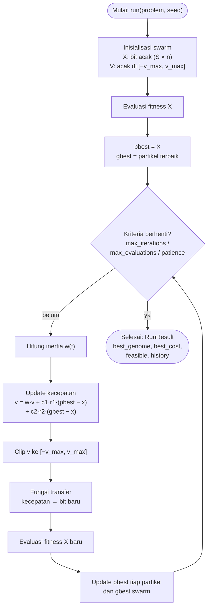
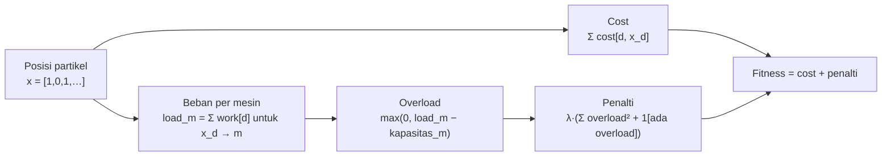

# Penerapan Swarm Intelligence: Binary PSO

> Bagian **Swarm Intelligence** dari tugas besar AI5103 pada dataset *Path Matters*.

Bagian ini memakai **Binary Particle Swarm Optimization (BPSO)** untuk mengalokasikan dieset flexible ke mesin `GP260` atau `GP640` dengan biaya minimum. Alasan pemilihannya dijelaskan di §2, dan alur prosesnya digambarkan di §3.

Kode bersama kelompok (`src/problem.py`, `src/algorithm/base.py`, `data/processed/preprocess.py`) **tidak diubah**. Preprocessing khusus swarm dibuat sebagai script terpisah.

---

## 1. Temuan Data yang Memengaruhi Desain

Brute-force atas semua $2^n$ kombinasi (paling banyak 524.288 untuk $n = 19$, selesai dalam hitungan detik) menghasilkan tiga temuan.

**a. Kapasitas mesin belum dikurangi beban dieset fixed.**
Semua dieset fixed dialokasikan ke `GP260`. Namun `preprocess.py` membuangnya tanpa mengurangi kapasitas mesin. Contohnya pada instance 3: dieset fixed sudah memakai 797,16 dari 953,03 jam, sehingga sisa kapasitas sebenarnya hanya 155,9 jam. README §1.2 sendiri menyebut dieset fixed tetap menyumbang beban kapasitas.

**b. Optimum paper bukan optimum terbaik untuk instance 16, 18, dan 19.**
Brute-force menemukan solusi feasible yang lebih murah 0,016–0,046%. Jika optimality gap dihitung terhadap nilai paper, gap bisa bernilai negatif.

**c. Masalahnya berstruktur 0/1 knapsack.**
- Untuk setiap dieset, gen 0 selalu `GP260` dan gen 1 selalu `GP640`.
- `work_hours` sebuah dieset sama di kedua mesin.
- `GP640` lebih murah untuk hampir semua dieset, kecuali satu dieset di instance 19.

Optimum selalu menempel di batas kapasitas. Untuk $n \ge 9$, `GP640` terpakai 99,4–99,9%. Untuk $n = 3$, yang ketat justru `GP260` (153,6 dari 155,9 jam).

| n dieset | Kapasitas residual GP260 / GP640 (jam) | Fraksi feasible (kapasitas penuh) | Fraksi feasible (kapasitas residual) | Optimum brute-force | Optimum paper | Selisih paper |
|---:|---:|---:|---:|---:|---:|---:|
| 3  | 155,9 / 146,6     | 50,0% | 12,5% | 443.483,21   | 443.483,21   | 0       |
| 9  | 385,2 / 378,8     | 66,6% | 35,0% | 2.249.378,78 | 2.249.378,78 | 0       |
| 13 | 886,9 / 967,8     | 72,6% | 36,0% | 5.223.596,12 | 5.223.596,12 | 0       |
| 16 | 1.090,1 / 1.189,6 | 76,4% | 42,5% | 5.801.121,21 | 5.803.504,82 | +0,041% |
| 18 | 1.119,4 / 1.293,0 | 80,7% | 43,8% | 5.962.911,99 | 5.963.876,62 | +0,016% |
| 19 | 1.099,5 / 1.456,2 | 88,4% | 42,4% | 6.112.960,59 | 6.115.761,14 | +0,046% |

Optimum brute-force sama untuk kapasitas penuh maupun residual. Yang berubah hanya ruang feasible-nya, yang menjadi jauh lebih sempit (instance 3 hanya punya **1 solusi feasible dari 8**).

Solusi yang hampir optimal juga sangat rapat. Di instance 18, solusi terbaik kedua hanya 0,002% di atas optimum, dan ada 24.177 solusi feasible dalam rentang 1% dari optimum. Karena itu, metrik "tepat optimum" saja tidak cukup (lihat §8).

---

## 2. Alasan Pemilihan Algoritma

BPSO dipilih terutama karena **karakteristik datanya**, ditambah dua alasan praktis.

### 2.1 Alasan dari karakteristik data

| Karakteristik data | Dampak ke pemilihan algoritma |
|---|---|
| Variabel keputusan biner. Di keenam instance, setiap dieset flexible hanya punya dua pilihan mesin (`GP260` atau `GP640`). Ruang pencariannya berupa hypercube $\{0,1\}^n$. | PSO standar dirancang untuk ruang kontinu ("dieset ke mesin 0,4" tidak bermakna). BPSO dirancang khusus untuk ruang biner: satu dimensi berarti satu dieset, dan kecepatan berarti peluang dieset itu ditaruh di `GP640`. |
| Assignment constraint otomatis terpenuhi. Satu bit per dieset menjamin setiap dieset mendapat tepat satu mesin (README §3.1). | Tidak perlu algoritma konstruktif, operator repair, atau encoding tambahan. Yang tersisa hanya capacity constraint, yang sudah ditangani penalty di `evaluate()`. |
| Dimensi kecil (3–19 dieset). | Kelemahan BPSO yang terkenal, yaitu performa turun di dimensi ratusan sampai ribuan, tidak muncul di sini. |
| Optimum menempel di batas kapasitas dan solusi hampir optimal sangat rapat (§1). | Pencarian butuh kontrol keseimbangan eksplorasi dan eksploitasi, karena satu bit yang salah bisa membuat solusi infeasible. BPSO menyediakan pengaturnya: inertia, `v_max`, dan fungsi transfer. Ketiganya sekaligus menjadi bahan studi parameter (§8). |

### 2.2 Alasan praktis

- **Sesuai skeleton kelompok.** `src/algorithm/swarm.py` sudah mendefinisikan `ParticleSwarm` dengan parameter `inertia`, `cognitive`, dan `social`.
- **Perbandingan dengan GA menjadi adil.** Representasi, fitness, dan penalty-nya sama persis dengan GA. Jadi kalau hasilnya berbeda, perbedaan itu murni berasal dari mekanisme pencarian: evolusi (crossover + mutasi) lawan swarm (pbest + gbest).

### 2.3 Alternatif yang dipertimbangkan

| Algoritma | Kecocokan | Alasan tidak dipilih sebagai metode utama |
|---|---|---|
| **Ant Colony Optimization (ACO)** | Tinggi. Semut membangun solusi dieset per dieset, dengan heuristik $\eta_d = (c_{d,0} - c_{d,1}) / w_d$ yang sesuai dengan struktur knapsack. Kemungkinan lebih cepat menemukan optimum. | Memakai pengetahuan khusus masalah yang tidak dimiliki GA, sehingga perbandingannya kurang setara. Tidak cocok dengan skeleton yang ada dan harus ditulis dari nol. Bisa menjadi pembanding tambahan jika tugas membolehkan. |
| **ABC, Firefly, Grey Wolf** | Sedang | Aslinya algoritma kontinu, jadi tetap butuh fungsi transfer biner seperti BPSO. Tidak ada keuntungan tambahan untuk data ini. |
| **PSO kontinu + pembulatan** | Rendah | Pembulatan posisi membuat banyak partikel terjebak di bit yang sama. BPSO adalah cara baku untuk menurunkan PSO ke ruang biner. |

---

## 3. Alur Proses

### 3.1 Alur keseluruhan (pipeline)


Langkah per tahap:

1. **Preprocessing** (§4): data QUBO asli diubah menjadi instance dengan kapasitas residual dan ground truth brute-force.
2. **Load instance**: file JSON dibaca menjadi matriks `cost`, `work`, dan `capacity` lewat `load_instance()` milik kelompok.
3. **Run BPSO** (§6): untuk setiap instance × konfigurasi × seed, swarm mencari genome terbaik sampai kriteria berhenti terpenuhi.
4. **Simpan hasil**: setiap run menghasilkan satu `RunResult`, berisi genome terbaik, cost, status feasible, dan riwayat konvergensi.
5. **Analisis** (§8): metrik dihitung terhadap optimum brute-force, lalu dibandingkan dengan baseline dan GA.

### 3.2 Alur satu run BPSO



Pembagian kerja di kode:
- **`initialize()`**: kotak "Inisialisasi" sampai "pbest/gbest awal".
- **`iterate()`**: dari "Hitung inertia" sampai "Update pbest/gbest".
- **`Algorithm.run()`** di `base.py`: pengecekan kriteria berhenti, pencatatan riwayat, dan pembuatan `RunResult`.

### 3.3 Alur evaluasi fitness satu partikel



### 3.4 Contoh perhitungan satu dimensi

Misalkan untuk satu partikel dan dieset $d$: posisi saat ini $x = 0$ (`GP260`), $v = 0$, sementara pbest dan gbest sama-sama bernilai 1 (`GP640`). Parameternya $w = 0{,}7$, $c_1 = c_2 = 1{,}5$, $r_1 = 0{,}5$, $r_2 = 0{,}8$:

$$v = 0{,}7 \cdot 0 + 1{,}5 \cdot 0{,}5 \cdot (1 - 0) + 1{,}5 \cdot 0{,}8 \cdot (1 - 0) = 0{,}75 + 1{,}2 = 1{,}95$$

- **Sigmoid**: $S(1{,}95) = 1 / (1 + e^{-1{,}95}) \approx 0{,}875$. Dengan peluang 87,5%, dieset $d$ pindah ke `GP640`.
- **V-shaped**: $T(1{,}95) = |\tanh(1{,}95)| \approx 0{,}960$. Dengan peluang 96%, bit di-*flip* dari 0 menjadi 1.

Kalau pbest dan gbest tidak sepakat (misalnya pbest = 0 dan gbest = 1), tarikannya saling melemahkan. Peluang bit berubah pun lebih kecil, dan swarm tetap mengeksplorasi.

---

## 4. Preprocessing Khusus Swarm

### 4.1 Lokasi dan cara pakai

| | Path |
|---|---|
| Script | `data/processed/preprocess_swarm.py` |
| Output instance | `data/processed/instances_swarm/instance_{n}_diesets.json` |
| Output ringkasan | `data/processed/instances_swarm_summary.csv` |

```bash
python data/processed/preprocess_swarm.py
```

Script ini **memakai ulang** fungsi `build_instance()` dari `preprocess.py` lewat `from preprocess import build_instance, SRC_DIR, INSTANCE_SIZES`. Import ini bisa jalan karena keduanya berada di folder yang sama. Hasil `build_instance()` kemudian diproses lanjut. Dengan cara ini tidak ada logika parsing yang diduplikasi, dan file milik kelompok tidak disentuh.

### 4.2 Langkah

1. Panggil `build_instance(n, info)` untuk mendapatkan instance versi kelompok.
2. Baca ulang `model.dieset_choices` dari JSON asli, lalu jumlahkan `work_required_hours` dieset fixed per mesin. Hasilnya `fixed_load_hours`.
3. Hitung kapasitas residual: `capacity_hours = max_capacity_hours_per_timeslice − fixed_load_hours`.
4. Lakukan brute-force atas semua $2^n$ genome, secara vektorisasi dengan numpy. Ambil genome feasible dengan cost terkecil sebagai ground truth.
5. Simpan solusi paper sebagai pembanding, di bawah key `paper_*`.
6. Validasi (lihat §4.4), lalu tulis JSON dan CSV ringkasan.

### 4.3 Format output

Skemanya **kompatibel** dengan `load_instance()` di `src/problem.py`, jadi tidak perlu loader baru. Field yang berubah atau bertambah:

```jsonc
{
  "n_diesets": 3,
  "n_machines": 2,
  "n_fixed_diesets_ignored": 13,
  "machines": [
    {
      "machine_id": 24, "machine_name": "GP260",
      "capacity_hours": 155.87,          // RESIDUAL = total − beban dieset fixed
      "capacity_hours_total": 953.03,    // baru: kapasitas asli
      "fixed_load_hours": 797.16         // baru: beban dieset fixed
    },
    { "machine_id": 27, "machine_name": "GP640", "capacity_hours": 146.65, "capacity_hours_total": 146.65, "fixed_load_hours": 0.0 }
  ],
  "diesets": [ /* sama persis dengan versi kelompok */ ],
  "ground_truth": {
    "source": "brute_force",
    "optimal_cost": 443483.21,                              // hasil brute-force
    "optimal_assignment_dieset_to_machine": {"3": 24, "2": 27, "0": 27},
    "n_feasible": 1,
    "n_total": 8,
    "paper_optimal_cost": 443483.21,                        // dari info.csv
    "paper_optimal_bitstring": "...",
    "paper_assignment_dieset_to_machine": {"3": 24, "2": 27, "0": 27}
  }
}
```

### 4.4 Validasi (`assert`)

- Cost dari `optimal_assignment_dieset_to_machine`, jika dihitung ulang, sama dengan `optimal_cost`.
- Solusi brute-force feasible terhadap kapasitas residual.
- Solusi paper juga feasible terhadap kapasitas residual. Ini sudah dicek: beban `GP260` di solusi paper selalu di bawah kapasitas residualnya.
- `optimal_cost ≤ paper_optimal_cost`.
- Untuk $n \in \{3, 9, 13\}$, assignment brute-force sama dengan assignment paper.

---

## 5. Representasi Partikel dan Fitness

**Posisi** partikel $x \in \{0,1\}^n$ sama dengan genome kelompok: $x_d = 1$ berarti dieset $d$ dialokasikan ke `choices[1]` (`GP640`). **Kecepatan** $v \in [-v_{max}, v_{max}]^n$ adalah bilangan kontinu, satu nilai per dieset.

Karena BPSO hanya cocok untuk dua pilihan per gen, `initialize()` akan memunculkan `ValueError` jika ada dieset dengan jumlah pilihan selain 2. Kondisi ini terpenuhi untuk keenam instance.

**Fitness** memakai `Algorithm.evaluate()` dari `base.py` tanpa perubahan, supaya perbandingan dengan GA adil (alurnya di §3.3):

$$f(x) = \sum_d c_{d,x_d} \; + \; \lambda \left( \sum_m \max(0, \text{load}_m - h_m)^2 + \mathbb{1}[\exists m: \text{load}_m > h_m] \right)$$

Nilai default $\lambda$ adalah batas atas cost (`cost_bounds()[1]`). Dengan begitu, solusi infeasible selalu lebih buruk daripada solusi feasible mana pun (feasibility-first).

---

## 6. Algoritma BPSO

### 6.1 Update kecepatan

Untuk partikel $i$ dan dimensi (dieset) $d$:

$$v_{id} \leftarrow w\,v_{id} + c_1 r_1 (p_{id} - x_{id}) + c_2 r_2 (g_d - x_{id}), \qquad r_1, r_2 \sim U(0,1)$$

$$v_{id} \leftarrow \text{clip}(v_{id}, -v_{max}, v_{max})$$

Keterangan:
- $p_i$ adalah posisi terbaik partikel $i$ (*pbest*).
- $g$ adalah posisi terbaik seluruh swarm (*gbest*). Nilainya diambil dari `self.best_genome`, yang sudah dikelola oleh `base.evaluate()`.
- Topologinya global (gbest).

### 6.2 Fungsi transfer (kecepatan → bit)

Ada dua varian. Keduanya diimplementasikan lewat parameter `transfer`.

| `transfer` | Rumus | Aturan update posisi | Sumber |
|---|---|---|---|
| `"sigmoid"` (S-shaped) | $S(v) = \dfrac{1}{1 + e^{-v}}$ | $x_{id} = 1$ jika $r < S(v_{id})$, selain itu $0$ | Kennedy & Eberhart (1997) |
| `"vshape"` (V-shaped) | $T(v) = \lvert \tanh(v) \rvert$ | bit di-*flip* jika $r < T(v_{id})$, selain itu tetap | Mirjalili & Lewis (2013) |

Perbedaan perilakunya:
- **Sigmoid**: saat $v \approx 0$, peluangnya 0,5. Artinya partikel yang sudah konvergen tetap mengacak bitnya.
- **V-shaped**: saat $v \approx 0$, bit tidak berubah. Partikel bisa "diam" di solusi yang bagus, dan perubahan hanya terjadi ketika ada tarikan dari pbest atau gbest.

### 6.3 Inertia dan pembatasan kecepatan

- **Inertia** konstan secara default (`inertia = 0.7`). Jika `inertia_end` diisi, inertia turun linear dari `inertia` ke `inertia_end`:
  $w(t) = w_0 - (w_0 - w_{end}) \cdot t / T_{max}$.
  $T_{max}$ diambil dari batas yang lebih dulu tercapai, yaitu `max_iterations` atau `max_evaluations // swarm_size`. Dengan begitu inertia tetap sampai ke `inertia_end` walaupun run dihentikan oleh budget evaluasi.
  Dengan setting 0,9 → 0,4, swarm lebih banyak eksplorasi di awal dan eksploitasi di akhir.
- **`v_max`** default 4,0, sehingga $S(v)$ berada di rentang $[0{,}018;\ 0{,}982]$. Tanpa batas ini, peluang menempel di 0 atau 1 dan pencarian berhenti.

### 6.4 Pseudocode

```text
initialize():
    assert semua dieset punya 2 pilihan
    X  ← random_genomes(S)                  # (S, n) bit acak
    V  ← U(−v_max, v_max)                   # (S, n)
    F  ← evaluate(X)                        # sekaligus update gbest di base
    P, Fp ← X.copy(), F.copy()              # pbest

iterate():
    w      ← inertia saat ini
    r1, r2 ← U(0,1)                         # (S, n)
    V ← clip(w·V + c1·r1·(P − X) + c2·r2·(gbest − X), −v_max, v_max)
    X ← transfer(V, X)                      # sigmoid: sampel ulang | vshape: flip
    F ← evaluate(X)
    better      ← F < Fp
    P[better]   ← X[better]
    Fp[better]  ← F[better]
```

Satu iterasi memakai $S$ evaluasi. Kriteria berhenti (`max_iterations`, `max_evaluations`, `patience`) sudah ditangani oleh `Algorithm.run()`.

### 6.5 Hyperparameter

| Parameter | Default | Keterangan |
|---|---:|---|
| `swarm_size` | 40 | jumlah partikel $S$ |
| `inertia` | 0,7 | $w$, atau $w_0$ jika `inertia_end` diisi |
| `inertia_end` | `None` | `None` berarti inertia konstan |
| `cognitive` | 1,5 | $c_1$ |
| `social` | 1,5 | $c_2$ |
| `v_max` | 4,0 | batas absolut kecepatan |
| `transfer` | `"sigmoid"` | `"sigmoid"` atau `"vshape"` |

Semua parameter ini dikembalikan oleh `extra_params()`, sehingga tercatat di `RunResult.params`.

---

## 7. Integrasi dengan Kode Kelompok

| File | Status | Isi |
|---|---|---|
| `data/processed/preprocess_swarm.py` | baru | preprocessing §4 |
| `data/processed/instances_swarm/` | baru (hasil generate) | 6 instance kapasitas residual + ground truth brute-force |
| `src/algorithm/swarm.py` | diisi | `ParticleSwarm(Algorithm)`: `__init__`, `extra_params`, `initialize`, `iterate`, helper `_inertia`, `_transfer` |
| `src/algorithm/baseline.py` | baru | `RandomSearch(Algorithm)` dan `greedy_knapsack()` untuk baseline §8.3 |
| `experiments/run_swarm.py` | baru | menjalankan seluruh percobaan §8, menyimpan hasil ke `results/swarm/` |
| `data/processed/preprocess.py` | perbaikan path | `SRC_DIR` sebelumnya menunjuk ke `data/src/QUBOS`, yang tidak ada. Sekarang menunjuk ke `data/original/src/QUBOS`. Logikanya tidak diubah, dan output `instances/` tetap identik. |
| `src/problem.py`, `src/algorithm/base.py` | tidak diubah | – |

Contoh pemakaian:

```python
from src.problem import load_instance
from src.algorithm import ParticleSwarm

problem = load_instance("data/processed/instances_swarm/instance_19_diesets.json")
pso = ParticleSwarm(swarm_size=40, transfer="vshape", max_evaluations=5000)
result = pso.run(problem, seed=0)
print(result.best_cost, result.feasible, (result.best_cost / problem.optimal_cost - 1) * 100)
```

Kode di atas dijalankan dari root repo, misalnya `PYTHONPATH=. python script.py`.

Perlu diperhatikan juga, `load_instances()` di `src/problem.py` mengimpor `src.paths`, padahal modul itu belum ada. Fungsi ini tetap error walaupun argumen `directory` diisi, karena import-nya dijalankan di awal fungsi. Untuk sementara, pakai `load_instance(path)` per file.

---

## 8. Rancangan Percobaan

### 8.1 Konfigurasi

- **Instance**: keenam instance di `instances_swarm/`.
- **Seed**: 30 seed (0–29) per konfigurasi per instance.
- **Budget**: berhenti berdasarkan `max_evaluations`, dengan nilai yang sama untuk GA dan BPSO (usulan: 5.000 evaluasi). Budget ini kurang dari 1% ruang pencarian instance 19. Untuk $n \le 9$, budget ini sudah melebihi ruang pencariannya (paling banyak 512 kombinasi), jadi hasil instance 3 dan 9 hanya berfungsi sebagai sanity check.

| Studi | Variasi | Parameter lain |
|---|---|---|
| Fungsi transfer | `sigmoid` vs `vshape` | default |
| Jadwal inertia | konstan 0,7 vs linear 0,9 → 0,4 | transfer terbaik |
| Ukuran swarm | 20, 40, 80 | budget evaluasi tetap |
| `v_max` | 4, 6 | transfer terbaik |

### 8.2 Metrik

| Metrik | Definisi |
|---|---|
| Success rate | % run dengan `best_cost` = optimum brute-force (toleransi 1e-3) |
| Near-optimal rate | % run dengan gap ≤ 0,1% |
| Optimality gap | $(\text{best\_cost} - \text{opt}) / \text{opt} \times 100\%$, dilaporkan mean, median, dan worst |
| Feasibility rate | % run yang hasil akhirnya feasible |
| Evaluasi sampai solusi terbaik | jumlah evaluasi saat solusi terbaik run ditemukan, yaitu `(best_iteration + 1) × swarm_size` |
| Runtime | `runtime_sec` |
| Kurva konvergensi | `history_best_cost` dirata-rata per iterasi |

### 8.3 Baseline

- **Brute-force**: solusi eksak (ground truth).
- **Random search** (`RandomSearch`): sampling genome acak dengan budget evaluasi dan ukuran batch yang sama (40). Ini menunjukkan seberapa besar kontribusi mekanisme swarm.
- **Greedy knapsack** (`greedy_knapsack()`): urutkan dieset berdasarkan rasio penghematan / jam, $(c_{d,0} - c_{d,1}) / w_d$, dari yang terbesar. Pindahkan dieset ke `GP640` selama kapasitasnya cukup, lalu cek kapasitas `GP260`. Hasilnya deterministik, jadi cukup satu run.
- **GA kelompok**: dibandingkan dengan uji Mann–Whitney U pada gap per seed.

### 8.4 Hasil

Cara menjalankan:

```bash
python experiments/run_swarm.py              # 30 seed, budget 5.000 evaluasi
python experiments/run_swarm.py --seeds 10   # versi cepat
```

Seluruh percobaan (6 instance × 8 konfigurasi × 30 seed = 1.440 run) selesai sekitar 30 detik. Output-nya ada di `results/swarm/`:
- `summary.csv`: metrik per instance dan konfigurasi
- `runs.csv`: satu baris per run
- `runs/<config>/<instance>/seed_XX.json`: `RunResult` lengkap per run
- `convergence.png`: plot konvergensi

Konfigurasi default adalah sigmoid, $w = 0{,}7$, $c_1 = c_2 = 1{,}5$, `v_max = 4`, dan $S = 40$. Konfigurasi lain hanya mengubah satu atau dua parameter dari default tersebut. Instance 3 dan 9 mencapai 100% success rate di semua metode, termasuk random search dan greedy, jadi tidak dimasukkan ke tabel.

**Success rate (%)**, yaitu persentase run yang tepat menemukan optimum brute-force:

| Konfigurasi | n = 13 | n = 16 | n = 18 | n = 19 |
|---|---:|---:|---:|---:|
| sigmoid | 93,3 | 36,7 | 13,3 | 16,7 |
| sigmoid, inertia 0,9 → 0,4 | 80,0 | 26,7 | 20,0 | 10,0 |
| V-shaped | 83,3 | 30,0 | 13,3 | 6,7 |
| V-shaped, inertia 0,9 → 0,4 | 86,7 | 10,0 | 23,3 | 0,0 |
| sigmoid, $S = 20$ | 90,0 | 30,0 | 16,7 | 20,0 |
| sigmoid, $S = 80$ | 86,7 | 26,7 | 16,7 | 3,3 |
| sigmoid, `v_max = 6` | 93,3 | 40,0 | 23,3 | 10,0 |
| random search | 46,7 | 3,3 | 3,3 | 0,0 |
| greedy (1 run) | 0 | 0 | 0 | 0 |

**Gap rata-rata ke optimum (%)**:

| Konfigurasi | n = 13 | n = 16 | n = 18 | n = 19 |
|---|---:|---:|---:|---:|
| sigmoid | 0,0018 | 0,0299 | 0,0085 | 0,0249 |
| sigmoid, inertia 0,9 → 0,4 | 0,0068 | 0,0286 | 0,0096 | 0,0360 |
| V-shaped | 0,0043 | 0,0408 | 0,0108 | 0,0499 |
| V-shaped, inertia 0,9 → 0,4 | 0,0047 | 0,0398 | 0,0116 | 0,0389 |
| sigmoid, $S = 20$ | 0,0024 | 0,0288 | 0,0087 | 0,0311 |
| sigmoid, $S = 80$ | 0,0017 | 0,0295 | 0,0117 | 0,0376 |
| sigmoid, `v_max = 6` | 0,0003 | 0,0270 | 0,0106 | 0,0321 |
| random search | 0,0078 | 0,0697 | 0,0356 | 0,0872 |
| greedy (1 run) | 0,1245 | 0,1385 | 0,2608 | 0,1011 |
| *solusi paper* | *0* | *0,041* | *0,016* | *0,046* |


Plot di atas menunjukkan median gap terhadap jumlah evaluasi. Sumbu-y memakai skala symlog: linear di dekat 0, logaritmik di atas 0,001%. Garis putus-putus adalah gap solusi paper terhadap optimum brute-force.

**Pengamatan**

1. Semua 1.440 run BPSO menghasilkan solusi feasible, dan gap terburuknya 0,11%. Penalty feasibility-first bekerja sesuai rancangan.
2. BPSO jelas lebih baik daripada random search dengan budget yang sama. Di $n \ge 16$, gap rata-rata BPSO 1,7–4 kali lebih kecil. Persentase run random search dengan gap ≤ 0,1% juga turun menjadi 66,7% di $n = 19$, sedangkan BPSO tetap 96,7–100%. Dari plot terlihat bahwa perbedaannya mulai muncul setelah beberapa ratus evaluasi pertama. Pada tahap itu random search mulai mendatar, sementara BPSO terus turun.
3. Greedy rasio penghematan/jam selalu meleset 0,10–0,26%. Artinya, walaupun strukturnya mirip knapsack, pilihan dieset yang optimal tidak bisa didapat hanya dengan mengurutkan rasio.
4. Rata-rata hasil BPSO sigmoid lebih baik daripada solusi paper di instance 16, 18, dan 19. Di $n = 18$, misalnya, gap rata-ratanya 0,0085% berbanding 0,016%.
5. Success rate turun tajam mulai $n = 16$. Penyebabnya bukan solusi yang buruk, melainkan rapatnya solusi yang hanya berbeda 0,002–0,03% dari optimum (§1). Swarm sering berhenti di salah satu solusi tetangga tersebut.
6. Fungsi transfer sigmoid konsisten sedikit lebih baik daripada V-shaped. Dugaan sementara: pada V-shaped, bit tidak berubah saat $v \approx 0$, sehingga swarm cepat "membeku" setelah pbest dan gbest sama.
7. Inertia linear, ukuran swarm, dan `v_max` tidak memberi perbedaan yang konsisten. Selisihnya kecil dan arahnya berubah-ubah antar-instance. Dengan 30 seed, perbedaan ini kemungkinan belum signifikan secara statistik, jadi perlu diuji (misalnya Mann–Whitney U) sebelum diklaim di laporan.

---

## 9. Rencana Kerja dan Hal yang Perlu Disepakati

**Rencana kerja**

- [x] Tulis `data/processed/preprocess_swarm.py` dan generate `instances_swarm/`
- [x] Implementasikan `ParticleSwarm` di `src/algorithm/swarm.py`
- [x] Buat baseline random search dan greedy
- [x] Jalankan percobaan §8 dan simpan `RunResult` ke JSON
- [x] Buat plot konvergensi dan tabel metrik (§8.4)
- [ ] Uji statistik antar-konfigurasi, dan BPSO vs GA setelah GA selesai
- [ ] Isi README §4–§6 bagian swarm

**Perlu disepakati dengan kelompok**

1. **Data yang dipakai untuk perbandingan GA vs BPSO.** Kalau GA memakai `instances/` (kapasitas penuh) dan BPSO memakai `instances_swarm/` (kapasitas residual), perbandingannya tidak adil. Usulan: keduanya memakai `instances_swarm/`.
2. **Ground truth**: brute-force atau nilai paper. Usulan: brute-force, dan nilai paper dicantumkan sebagai catatan.
3. **Budget evaluasi dan jumlah seed** bersama (usulan: 5.000 evaluasi, 30 seed).

---

## Referensi

1. J. Kennedy and R. C. Eberhart. *A discrete binary version of the particle swarm algorithm.* IEEE International Conference on Systems, Man, and Cybernetics, 1997.
2. S. Mirjalili and A. Lewis. *S-shaped versus V-shaped transfer functions for binary Particle Swarm Optimization.* Swarm and Evolutionary Computation, 9:1–14, 2013.
3. Y. Shi and R. Eberhart. *A modified particle swarm optimizer.* IEEE International Conference on Evolutionary Computation, 1998.
4. L. Schmidbauer et al. *Path Matters: Industrial Data Meet Quantum Optimization.* IEEE QCE 2025. arXiv:2504.16607.
